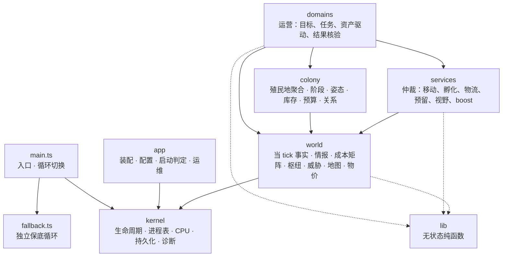
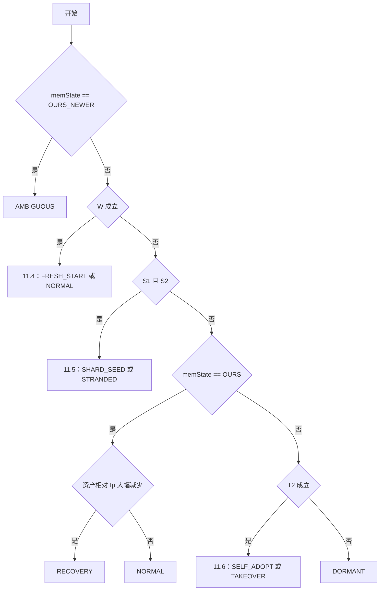

# Screeps 自动化运营系统架构设计

| 项目 | 内容 |
| --- | --- |
| 版本 | 3.1 |
| 日期 | 2026-10-19 |
| 状态 | 设计定稿，待实施 |
| 适用环境 | Screeps World 官方服务器（多 shard）与私有服务器（单 shard） |

**阅读顺序**：第 1–3 章是总览；第 4 章是总体架构；第 5–9 章自底向上逐层设计（内核 → 持久化 → 世界模型 → 服务 → 运营层）；第 10 章是 M2 起线上闭环所依赖的基础运营规则；第 11 章是启动判定与特殊模式；第 12 章是实现规范；第 13 章是工程与运维；第 14 章是开发阶段与里程碑；第 15 章是风险与待补设计。

---

## 1. 概述

### 1.1 目标

本系统是一套能长期无人值守运营的 Screeps 脚本。它可以从三种起点开始运营：全新开局、接手已有资产的账户、由其他 shard 派出 creep 建立的新据点。之后自动完成经济发展、产业经营、扩张与防御，并在 CPU 不足、代码故障、部署或 global reset 时保持运转。

### 1.2 设计目标（按优先级）

1. **生存优先。** 任何故障下房间都不丢失：控制器不降级，spawn 能量不断，tower 持续开火。
2. **线上持续闭环。** 从第二个里程碑起，每个发布版本都在官方服务器上无人值守运行；新功能以增量方式上线，可随时回滚。
3. **CPU 效率。** 单位产出的 CPU 成本最低。运行成本随冲突和变化增长，而不是随实体总数增长。
4. **可恢复。** 所有 heap 状态都能在 global reset 后重建；持久化状态带版本号并支持迁移。
5. **可接手。** 能正确识别开局、接手、跨 shard 据点等特殊局面，并安全处置。
6. **可测试。** 决策逻辑能脱离游戏环境验证。

### 1.3 非目标

- 运行期热插拔代码模块。代码只能通过部署变更，而部署必然触发 global reset。
- 通用的跨 tick 计算调度器。长计算由调用方自行分片。
- 通用事件总线。只有出现真实的一对多事实通知需求时才引入。

### 1.4 术语

| 术语 | 含义 |
| --- | --- |
| global reset | 脚本运行环境被重建，heap 中的全部状态丢失 |
| bucket | 未用完的 CPU 累积，上限 10000，可在单 tick 内透支使用 |
| intent | 一次改变游戏状态的动作提交，例如 `move`、`harvest`、`transfer` |
| 殖民地 | 一个自有房间及其附属的外矿、预定房 |
| 静态模块 / 动态实例 | 构建期确定的模块；由模块按殖民地或站点派生的运行实例 |
| 存储单元 | Memory 中身份与版本的单位：模块分区或实体记录切片 |
| 运行姿态 | 殖民地在经营轴与安全轴上的当前取值（9.3.3） |
| 库存位置 | 现存量加在途量减已承诺量，是库存控制的测量值（9.3.4） |
| 战役 | 军事领域管理的一次主动作战（9.10） |
| 闭环运行基线 | 线上版本必须持续满足的运行指标集合（14.2） |

### 1.5 文档体系与成熟度

本文档只描述架构、模块职责与跨模块契约。模块内部的算法细节放在模块设计文档中。

模块设计文档的位置与源码目录一一对应：`src/<路径>/` 的设计写在 `docs/design/<路径>.md`，例如 `src/colony/inventory/` 对应 `docs/design/colony/inventory.md`；同一层内跨模块的设计写在该层目录的 `README.md`，例如 `docs/design/world/README.md`。下表路径相对于 `docs/design/`：

| 模块设计文档 | 内容 |
| --- | --- |
| [app/config.md](./app/config.md) | 劳动力配置、身体模板、孵化优先级与运营参数 |
| `kernel/memory.md` | Memory 块级标脏与分级序列化缓存（候选） |
| `colony/inventory.md` | 库存控制器的设定值表、控制律、分配器与整定 |
| `world/market.md` | 物价模型的数据来源与价格估计 |
| `domains/industry/economics.md` | 产业规划的 v1 规则与 v2 风险调整优化 |

其余模块的设计文档在实施该模块时编写（13.1）。

每节标题下标注**成熟度**：

| 成熟度 | 含义 |
| --- | --- |
| 定稿 | 实施依据，标注实施的里程碑 |
| 方向 | 职责与接口已确定，实施前在模块设计文档中细化 |
| 候选 | 不绑定里程碑，由实测数据触发才实施（14.4） |

---

## 2. 运行环境约束

下表列出决定本设计的平台约束，依据见附录 A。

| 约束 | 数值或行为 | 对设计的影响 |
| --- | --- | --- |
| tick 模型 | 每 tick 执行一次 `loop`，所有动作在 tick 末统一结算 | 返回 `OK` 只表示动作已提交，结果在下一 tick 核验 |
| CPU | 账户 CPU 上限加 bucket；超时被硬终止 | 按层准入、按预算分配，并预留收尾 CPU；每个阶段都能被中断后恢复 |
| intent 成本 | 每个返回 `OK` 的状态变更动作约 0.2 CPU | 倾向少而大的 creep；不提交无效动作；推挤计入成本 |
| global reset | 部署、服务器重启、VM 回收都会清空 heap | heap 只作为缓存，必须能惰性重建 |
| 主 Memory | 上限 2 MB 文本；引擎在本 tick 首次访问时解析整个文本，tick 末写回 | 接管 Memory，每个 global 只解析一次；按存储单元增量序列化 |
| Segment | 100 页 × 100 KB；同时最多激活 10 页；激活在下一 tick 生效 | 作为显式异步的冷存储 |
| InterShardMemory | 官服每个 shard 一份，可读其他 shard；私服不提供 | 跨 shard 协议先做特性检测 |
| creep 生命周期 | 寿命 1500 tick；每个身体部件孵化 3 tick；单个 creep 最多 50 个部件 | 提前孵化接替者 |
| creep 动作 | transfer 与 withdraw 可在同一 tick 执行，withdraw 按 tick 开始时的空余容量检查；相邻 spawn 可以续命，续命后寿命不超过 1500 | 中央枢纽 creep 按交替模式搬运，以续命代替换代（9.7） |
| 工作效率 | 每个 WORK 每 tick：采集 2 能量、升级消耗 1 能量、建造消耗 5 能量、维修 100 hits（每 hit 0.01 能量） | 劳动力按预算换算，规则见 [app.config](./app/config.md#workforce) |
| terminal 与存储 | terminal 每次发送至少 100，发送后冷却 10 tick；storage、terminal、factory 容量分别为 1,000,000、300,000、50,000 | 跨殖民地调运用补货策略；库存设定值之和受容量约束（9.3.4） |
| 跨 shard | creep 名称保持不变，对象 id 不保证保持 | 跨 shard 识别以名称为准 |
| 市场 | 每种资源提供近 14 天的每日成交统计；挂单收 5% 手续费；terminal 运输消耗 `ceil(数量 × (1 − e^(−距离/30)))` 能量 | 物价模型以历史为主、挂单簿为辅，运输成本计入价格 |
| NPC 入侵者 | 房间 source 的累计采集量达到阈值后出现；自有房间 RCL ≥ 4 时为大型入侵者 | 防御基线从 M2 起就必须具备（10.7） |
| 代码分支 | 官服支持多个代码分支，可切换生效分支 | 发布与回滚以分支切换完成 |
| JS 运行环境 | 官服运行在 Node 24 上 | 编译目标为 ES2024，可直接使用 ES2024 的语法与内置 API |
| 运行时依赖 | 只有原生 API | 寻路只用原生 `PathFinder`；运行时零 npm 依赖 |

---

## 3. 设计原则

1. **业务闭环优先。** 每个阶段都以可运行、可测量的运营闭环作为交付物，基础设施随闭环的需要逐步完善。
2. **线上版本永远可运行。** 新能力以"默认暂停"的方式上线，验证后再启用；任何发布都可以一步回滚。
3. **出现第二个使用方才抽象。** 公共服务从已有业务中提取，不预先设计没有使用方的能力。
4. **先做简单版本，由数据触发升级。** 复杂算法先交付满足需求的 v1，只有实测数据证明有必要时才实施进阶版本（14.4）。
5. **需求每 tick 重新声明，只持久化"计划"和"事实"。** 孵化、运输、移动这类跨模块请求每 tick 重新声明，因此不需要持久化，也不需要恢复协议。
6. **intent 成本优先。** 中大规模下动作提交是最大的 CPU 来源。先问"能否少提交一个动作"，再问"能否少算一次"。
7. **指标驱动。** 每项优化和验收都以游戏内统计为准；本地 Node 环境的耗时不能等同于游戏 CPU。
8. **heap 是工作副本。** 持久化层只保存恢复所必需的最小信息。
9. **运营与布局、身体组成无关。** 领域模块不假设建筑位置或 creep 身体，而是在使用时从事实推导用途和能力，因此能直接运营非本系统建造的基地。
10. **不可逆操作必须有证据并经过闸门。** 清空 Memory、拆除建筑、让 creep 自杀、放弃控制器、撤销订单，都需要足够强的证据、执行前备份，并能由人工介入。

---

## 4. 总体架构

> 成熟度：定稿 · M1

### 4.1 分层与职责



| 层 | 职责 | 不承担 |
| --- | --- | --- |
| kernel | tick 生命周期与阶段、进程表、CPU 准入与预算、故障隔离、Memory 与 segment、日志、计时、错误映射、统计 | 任何游戏业务判断 |
| world | 世界事实：当 tick 对象缓存、情报、成本矩阵、中央枢纽、威胁、地图、物价模型 | 决策 |
| services | 跨实例仲裁：交通结算、孵化、物流撮合、库存预留、视野、boost | 制定运营目标 |
| colony | 殖民地聚合数据、发展阶段、运行姿态、资源库存控制、经济预算、殖民地间关系 | 执行动作 |
| domains | 运营目标、任务安排、资产驱动、结果核验 | 向下层提供基础服务 |
| lib | 网格算法、坐标、身体组成、命名、布局模式、常量表 | 任何可变状态 |
| app | 装配、配置、启动判定、运维命令 | 运营逻辑 |

services 每 tick 主动运行，对阶段顺序敏感，这是"意图收集后统一结算"模式的直接结果（4.4）。

### 4.2 依赖规则

| 规则 | 理由 |
| --- | --- |
| 依赖只能从上往下：domains → services / colony → world → kernel | 下层不感知上层，可以独立测试和替换 |
| 有状态、有身份或有生命周期的能力只能通过上下文注入取得，不得导入 `kernel/` 的实现，也不得通过默认参数、模块级单例或临时工厂在内部创建兜底实现 | 身份自动绑定，生命周期由宿主管理，模块只拥有最小权限，依赖对宿主可见 |
| 持久化存储只经 kernel 的 memory、segments、intershard 模块访问；其他模块不得读写全局 `Memory`、`RawMemory`（含 segment 接口）、`InterShardMemory`、原生 `*.memory` 与 `spawnCreep` 的 `memory` 选项，也不得自行解析存储文本或把跨 global 状态放入外部共享对象 | 保证单元级序列化、版本迁移与启动判定所依赖的唯一数据入口（第 6 章） |
| 无状态纯函数放在 `lib/`，可直接导入；`lib/` 中不得有模块级可变状态 | 纯函数没有身份和生命周期，注入它们只会徒增手续 |
| 领域之间只通过 `ctx.services` 与 colony 协作，不互相导入内部实现 | 各领域内部状态互不可见，可以独立演进 |
| 测试在装配边界显式注入依赖，不为测试便利在生产代码中保留隐藏的缺省依赖 | 测试与生产使用同一套装配方式，边界规则不因测试而失效 |

以上规则由静态边界测试检查（13.2）。

`fallback.ts` 是独立的应急执行入口，不导入其他项目模块（包括 `lib`），不读写持久化状态；只有 `main.ts` 负责选择正常循环或保底循环。保底直接使用游戏 API，不经正常服务仲裁，边界与预算限制见 5.7。

### 4.3 代码组织

```text
src/
├── main.ts          入口与正常 / 保底循环切换
├── fallback.ts      独立保底循环
├── settings.ts      使用者设置：经常手动切换的运行开关（日志级别默认值等）
├── kernel/          lifecycle、process、cpu、context、memory、segments、intershard、
│                    logger、profiler、errorMapper、stats、console、bootPort
├── lib/             grid、geometry、body、naming、combat、layout、tables、collections、hash
├── world/           roomCache、intel、costMatrix、hub、threat、map、market
├── services/        movement、spawnQueue、logisticsBroker、ledger、vision、boostBroker
├── colony/          registry、stage、posture、inventory、governor、relations
├── domains/
│   ├── economy/     bootstrap、mining、upgrade、build、logistics、remote、planner
│   ├── industry/    economics、mineral、labs、factory、power、highway、market
│   ├── security/    defense、military、nuke
│   └── expansion/   scouting、expansion、interShard、diplomacy、decommission
├── contracts/       注入接口与跨模块协议
└── app/             assembly、config、profiles、boot、ops、policy
```

`settings.ts` 集中存放使用者经常手动切换的运行开关，例如日志各级别的默认开关；调参用的配置表（身体模板、阈值等）仍在 `app.config`。它只导入 contracts 的类型，只被 `app.assembly` 与 `main.ts` 导入；其他层不直接读取它，由装配方把其中的值作为参数注入（4.2 的显式注入）。

**代码按领域组织，运行时按殖民地实例化。** 多数领域同时跨越房间范围和 shard 范围（例如物流同时负责房内运输和终端跨房平衡）。按作用域拆分代码，会让本该在模块内部直接协作的逻辑被迫改走公共协议。因此一个领域目录同时包含殖民地实例部分和全局单例部分，运行时由 kernel 为每个殖民地或站点派生实例。

### 4.4 运行模型

**tick 流水线：**

| 序 | 阶段 | 执行者 | 内容 |
| --- | --- | --- | --- |
| 1 | boot | app.boot | 启动判定（第 11 章）。global reset 时完整判定，平时只检查廉价不变量 |
| 2 | sense | kernel、world | 惰性构建当 tick 缓存；一次遍历 `Game.creeps`，按归属分组 |
| 3 | plan | domains 实例 | 声明需求：孵化与续命请求、运输请求与供给、视野与 boost 请求、姿态请求 |
| 4 | arbitrate | colony、services | 先由 colony.posture 裁决姿态、colony.inventory 按控制周期更新控制量、governor 计算预算；再由各服务仲裁：孵化队列出队并执行，物流撮合并下发分配，库存预留，视野分配 |
| 5 | act | domains 实例 | 执行工作动作（harvest、transfer、upgrade 等），登记移动意图 |
| 6 | move | movement | 交通结算，统一提交 `move` |
| 7 | commit | kernel | 提交 Memory 脏单元，segment 调度与写回，写入统计 |

move 必须在 act 之后：搬运类 creep 要先拿到 arbitrate 的分配结果，才知道往哪里走。

**进程模型：** kernel 进程表同时容纳静态模块和动态实例（每个 source、每个外矿、每个 lab 集群各一个实例）。这样做的好处是：

- 只有一个宿主，房间级的创建、退役、故障隔离和 CPU 轮转只实现一次；
- 故障隔离和熔断细到实例，一个房间的 Lab 出错不影响其他房间；
- CPU 降级细到实例，可以只停掉某个殖民地的外矿而保留它的 spawn。

代价是计时标签和健康记录的数量随"房间数 × 站点数"增长，需要控制每条记录的 heap 大小。

### 4.5 基础层模块清单

运营层的领域清单见 9.4；工程交付物见 13.1。

| 层 | 模块 | 职责 |
| --- | --- | --- |
| kernel | lifecycle | 主循环与 tick 阶段流水线 |
| | process | 进程表、拓扑排序、故障隔离、熔断 |
| | cpu | 分层准入、CPU 预算分配、收尾预留 |
| | context | 模块上下文与实例上下文的派生 |
| | memory | 接管 Memory、命名空间、分区与实体空间、长路径读写、单元级标脏、迁移、回收、体积统计 |
| | segments | segment 冷存储、读写调度、备份区 |
| | intershard | InterShardMemory 封装与特性检测 |
| | logger | 作用域日志 |
| | profiler | 计时与性能统计 |
| | errorMapper | 错误规范化与源码映射 |
| | stats | 统计采集与统计 segment 输出 |
| | console | 控制台命令注册与分发 |
| | bootPort | boot 阶段特权操作（备份、清空、软重置） |
| lib | grid | 距离变换、多源 BFS、洪水填充、邻居迭代 |
| | geometry | 坐标打包、房间坐标、方向与距离 |
| | body | 身体模板展开、身体成本、孵化时间、能力计算、用途分类器 |
| | naming | 命名规范、签名与校验 |
| | combat | tower 伤害、治疗与伤害估算 |
| | layout | 布局模式定义，例如中央枢纽判定 `hubPattern` |
| | tables | RCL 建筑上限、反应与商品配方等常量表 |
| | collections | 优先队列、分桶队列、LRU |
| | hash | 稳定哈希 |
| world | roomCache | 当 tick 房间对象缓存 |
| | intel | 房间情报、评分、新鲜度 |
| | costMatrix | 成本矩阵变体与失效 |
| | hub | 中央枢纽事实（依据实际建筑坐标检测） |
| | threat | 敌方单位追踪、威胁评估、威胁场 |
| | map | 房间状态、路线权重、portal 与跨 shard 拓扑 |
| | market | 市场历史与挂单采样、物价模型、价格查询 |
| services | movement | 寻路、路径缓存、意图、交通结算、逃离 |
| | spawnQueue | 孵化与续命请求的仲裁与执行、提前孵化、出生方向 |
| | logisticsBroker | 运输请求与供给撮合 |
| | ledger | 库存数量预留与释放 |
| | vision | observer 视野请求仲裁 |
| | boostBroker | boost 请求与 lab 供给的撮合 |
| colony | registry | 殖民地的建立、退役、房间角色、实例清单 |
| | stage | 发展阶段判定 |
| | posture | 运行姿态（经营轴、安全轴）的请求、仲裁与持久化 |
| | inventory | 资源库存控制：设定值、库存位置、控制量、缺口与盈余声明 |
| | governor | 可调能量预算的分配与关系预留 |
| | relations | 殖民地间关系（扶持、前线基地、补给基地） |
| app | assembly | 模块清单与装配 |
| | config | 劳动力配置、优先级、身体模板、阈值等配置表 |
| | profiles | 官服与私服的特性开关 |
| | boot | 启动判定、特殊模式、不可逆操作闸门 |
| | ops | 运维命令（启停、恢复、强制模式、诊断） |
| | policy | bucket 与 pixel 策略 |

---

## 5. 内核（kernel）

> 成熟度：定稿 · M1（5.3 的目标值在 M2 实测后校准）

### 5.1 进程表

- **静态模块**：构建期清单 `{id, requires, optional, tier, priority}`，启动时做一次稳定拓扑排序。
- **动态实例**：身份由稳定键派生，例如 `mining:W1N1:<sourceId>`，global reset 后不变；随房间集合和站点集合变化而创建或退役；继承所属模块的层级和顺序，在桶内按优先级排列，不参与拓扑排序。
- **钩子**：进程按需实现 `plan`、`act` 等阶段钩子，每个钩子在独立的错误边界中执行。
- **熔断**：连续失败达到阈值后熔断该进程，可通过运维命令 `recover(id)` 恢复。静态模块熔断时，依赖它的模块及其全部实例一起暂停。

### 5.2 CPU 分层与准入

| 层 | 准入条件（默认） | 内容 |
| --- | --- | --- |
| 生存 | 总是准入，但不越过收尾预留 | boot、孵化、tower、bootstrap、移动结算 |
| 经济 | 本 tick 预算有剩余（bucket 低于目标时预算已经收缩，5.3） | 采集、物流、升级 |
| 维护 | 本 tick 预算有剩余；每 N tick 一次，按 `hash(id) % N` 错峰 | 建造、修复、Lab、Factory、库存控制 |
| 规划 | bucket ≥ 1500 且本 tick 预算有剩余；事件触发或低频执行 | 布局、扩张评估、产业规划 |

- **实例准入过滤**：app 向 kernel 注册通用过滤函数 `admit(instanceKey) → {run, tierOverride?}`，kernel 每 tick 准入时调用。殖民地的运行姿态通过它生效（9.3.3）；kernel 不理解姿态的语义。
- 降级顺序是先按层、再按殖民地：先保证所有殖民地的生存层，再依次加入其他层；同一层内按殖民地姿态的优先级排列（9.3.3）。
- **剩余预算**：只使用扣除收尾预留后的可分配份额；维护层的执行周期与错峰不因取消 bucket 门槛而取消。`BUCKET_TARGET` 仍为 5000，规划准入门槛不改变回补目标。
- **预计耗用预检**：除生存层外，实例进入运行前比较"平滑耗用 ≤ 所属殖民地本层剩余份额"，放不下的本 tick 不进入、下一 tick 优先（5.3）。避免昂贵实例在预算将尽时开始运行，挤占收尾预留。
- 长计算由调用方自行分片并保存游标，每 tick 检查剩余预算。

### 5.3 CPU 预算

准入规则回答"谁先运行"，预算回答"每 tick 花多少、怎么分"。

**每 tick 可用预算：**

```text
B = Game.cpu.limit + 透支额
透支额 = clamp((bucket − BUCKET_TARGET) / BUCKET_DRAIN, −Game.cpu.limit × 0.2, Game.cpu.tickLimit − Game.cpu.limit)
```

bucket 高于目标时允许透支，使 bucket 在 `BUCKET_DRAIN` tick 内回落到目标；低于目标时少花一些，让 bucket 回补。

**分配顺序：**

1. 收尾预留：供 move 与 commit 使用，默认为 B 的 10%，至少 2 CPU；
2. 生存层：不设份额上限，按实际消耗；
3. 其余各层：按层依次分配，同一层内按殖民地份额分配。殖民地份额按"姿态优先级 × 殖民地价值"归一化；实例超出所属殖民地的份额时本 tick 让出，下一 tick 优先。

**计量**：每个实例的 CPU 用指数平滑记录，写入统计，用于准入预检、份额计算和发现异常的高消耗实例。

**初始目标**（M2 实测后校准，作为后续版本的回归基准）：

| 指标 | 目标 |
| --- | --- |
| kernel 与 world 的固定开销 | ≤ 1.5 CPU/tick |
| 平均每个 creep（含其 intent） | ≤ 0.35 CPU/tick |
| 单个 RCL8 殖民地（无外矿） | ≤ 8 CPU/tick |
| bucket 7 日均值 | ≥ `BUCKET_TARGET` |

### 5.4 上下文

```ts
interface ModuleContext {
  readonly id: ModuleId;
  readonly log: Logger;                 // 作用域已绑定
  readonly measure: Measure;            // 计时标签已绑定
  readonly cpu: CpuBudget;              // 按层准入与剩余预算
  readonly memory: PartitionFactory;    // 申请本模块的 Memory 分区
  readonly rooms: EntitySpace;          // 房间空间：of(name) 本模块切片，core(name) 只读
  readonly creeps: EntitySpace;         // creep 空间
  readonly flags: EntitySpace;          // flag 空间
  readonly segments: SegmentStore;      // 只看到分配给本模块的页
  readonly services: ServiceResolver;   // setup 时解析一次即可持有
  readonly mode: BootModeView;          // 启动判定结果，只读
  onDispose(fn: () => void): void;
  instance(key: string): InstanceContext; // 惰性派生并缓存；日志、计时、CPU 归属细到实例
}
```

没有运行期热替换，服务对象在整个 global 生命周期内稳定，可以在 setup 时解析并持有。

### 5.5 启停、熔断与软重置

- **启停**：Memory 中保存启停标志，下一 tick 生效。语义是**暂停**：跳过钩子，不释放实例，也不重新 setup。新领域以"默认暂停"上线（13.3）依赖这一机制。
- **软重置**：丢弃全部 heap 缓存、进程实例和路径缓存，效果等同于一次 global reset。只由 boot 在 global 运行中途判定出开局时触发（11.4）。

### 5.6 boot 特权端口

仅在 boot 阶段有效，只提供给 `app.boot`：读取原始 Memory 概要（是否为空、能否解析、根键、项目标记）；把原始 Memory 备份到 segment 备份区；整体清空 Memory；清空本 shard 的 InterShardMemory；触发软重置。kernel 只执行这些操作，不理解它们的游戏含义。

### 5.7 保底循环

`main.ts` 最外层用 try/catch 包住正常循环的初始化与执行。kernel 抛出可捕获异常，或连续 N tick 进入安全模式时，调用独立的 `src/fallback.ts`。保底有效代码不超过 400 行（不计空行和纯注释行），不导入其他项目模块，不读写 `Memory`、`RawMemory`、`InterShardMemory` 或原生 `*.memory`，不使用 `spawnCreep` 的 `memory` 选项。接管计数可由入口在 heap 保存，reset 后重新判定。

**最小闭环：**

1. 每座可用 tower 攻击最近的敌方 creep；没有攻击目标且预算、能量允许时，治疗受伤的己方 creep。
2. 本房缺少可用采集者且没有正在孵化的应急接替者时，用当前能量孵化最小采集者；角色从有效身体部件、位置和能量判断，不要求正常系统的角色记录。
3. 执行简单的本房能量物流：可移动的 CARRY creep 从 storage、container、掉落能量、墓碑或废墟取能，给 spawn、extension 与应急 tower 补能；没有可取能量时，由具备采集能力且可到达 source 的 creep 采集。固定工作 creep 仅执行当前位置可完成的动作。
4. 控制器剩余降级时间低于应急阈值时，优先为防降级保留能量，并安排可到达升级范围、具备有效 WORK 且有能量的 creep 升级；空载时先取能，不把刚提交的取能当作已经完成。

**运行约束：**

- 每房间每 tick 只收集一次所需对象，使用当 tick 的目标分配和数量预留避免重复孵化、多人争抢同一小额供给或重复补满同一目标；不建立持久任务队列。
- 依据 `Game.cpu.getUsed()` 与 `tickLimit` 限制接管后的工作量，预留退出余量；先保障防御、紧急防降级与补能链，预算不足时跳过次要工作。寻路只在本房进行，限制调用次数与 `maxOps`，允许直接调用 `PathFinder.search` 和 `creep.move`；不依赖正常 movement，也不使用隐式写入 Memory 的移动缓存。
- 按房间及单个资产隔离异常；接管发生在正常循环部分执行之后时，不能假定此前没有提交 intent，不对同一动作反复提交重试。
- 应急 creep 使用独立名称 `fb-<来源 shard>-<完整 tick 的 base36>-<同 tick 序号>`，不依赖 `lib.naming`；生成前检查当前及正在孵化的名称，并保留本 tick 已分配名称。正常循环恢复后按事实纳入遗留池并认领（9.1、11.6），应急前缀不作为清空 Memory 的签名证据。
- CPU 硬终止无法由 catch 接管；保底只能在仍有 CPU 时运行，或在后续 tick 根据可用故障证据提前接管。它用于回滚前尽量维持生存闭环，不对能量耗尽、资产被摧毁或 CPU 已耗尽的情形承诺保住房间。

### 5.8 可观测性

- **统计 segment**：按殖民地记录各层 CPU、实例 CPU、intent 数、能源收支、各资源的设定值与库存位置、spawn 繁忙率、闲置 creep 数、受阻浪费的 creep·tick、10.8 的经营指标、bucket、熔断次数、当前模式与姿态、版本号，供外部采集端读取（13.4）。
- **计时**：标签为 `模块ID.操作`；实例级按实例键聚合，不含 tick、creep 名等无界字段。
- **控制台**：模块状态、熔断、启停、`recover`，以及启动判定相关命令（11.9）。

---

## 6. 持久化

### 6.1 结构层次

> 成熟度：定稿 · M1

主 Memory 分三级组织：命名空间 → 存储单元 → 值。存储单元（模块分区、实体记录切片）是身份、版本、标脏与序列化的单位。

```text
Memory 文本
└── 项目命名空间 NS
    ├── sys       项目标记与启动判定状态（6.7）
    ├── part      模块分区：part[owner][localId]
    ├── rooms     房间空间：rooms[房间名][切片]
    ├── creeps    creep 空间：creeps[creep 名][切片]
    └── flags     flag 空间：flags[flag 名][切片]
```

| 层级 | 身份 | 版本 |
| --- | --- | --- |
| 命名空间 | 固定名称 `sys`、`part`、`rooms`、`creeps`、`flags` | 命名空间 schema |
| 存储单元 | 分区 `(owner, localId)`；切片 `(空间, 实体键, 切片名)`；owner 由上下文自动绑定 | 每个单元各自声明 |

### 6.2 标脏与序列化

> 成熟度：单元级定稿 · M1；块级候选（`kernel/memory.md`）

- **单元级标脏（v1）**：任何写入只标脏它所在的存储单元。commit 时只对脏单元执行 `JSON.stringify` 并缓存结果，再与其他单元的缓存串拼接成根串，调用一次 `RawMemory.set`。**没有脏单元的 tick 不写入。**
- **为什么实体切片也是单元**：creep 的任务字段几乎每 tick 都在变。如果整个 creep 空间是一个单元，每次写入都要重新序列化所有 creep 的记录；以切片为单元后，只重新序列化变化的那一条。
- **首次提交**：global reset 后缓存为空，第一次提交完整编码一次，此后进入增量模式。
- **块级标脏（候选）**：当 Memory 总长度或序列化 CPU 超过阈值时，把大分区内部再切分为块，并增加分级缓存。对外接口不变，触发条件与设计见 `kernel/memory.md`。

### 6.3 长路径读写

> 成熟度：定稿 · M1

```ts
interface Accessor<T> {
  get(path): DeepReadonly<V> | undefined;              // 只读引用，不复制、不冻结
  has(path): boolean;
  keys(path): readonly string[];
  set(path, value, opts?: { create?: boolean }): void; // 写入值的副本
  update(path, fn: (draft) => void): void;             // 回调内原地修改
  delete(path): boolean;
}
```

- **路径**：非空数组；字符串段对应对象键，非负整数段对应数组下标；不按点号拆分；拒绝 `__proto__`、`prototype`、`constructor`。路径与值的类型由数据类型推导，最多 8 段。
- **`set`**：写入前校验值是否为合法 JSON（普通对象、数组、有限数字、字符串、布尔、null），写入副本。中间容器缺失时默认报错，`create: true` 时自动创建普通对象；数组不自动扩容。
- **`update`**：回调内允许任意原地修改，标脏所在单元，该单元在 commit 时完整校验。回调抛错不回滚。
- **`delete`**：删除成功才标脏。数组元素在 `update` 中用 `splice` 删除。
- **只读约定**：`get` 返回的引用不得直接修改，否则不会标脏。开发构建在 commit 时对未标脏的单元做抽样哈希比对，以发现违规修改。

### 6.4 实体空间（room / creep / flag）

> 成熟度：定稿 · M1

每个实体一条记录，记录按切片划分；每个切片是一个存储单元，不同模块对同一实体的写入不会互相导致重新编码。

| 切片 | 内容 | 写入权限 | 读取权限 |
| --- | --- | --- | --- |
| `core` | creep：归属与任务 `{o, r, h, t}`（9.1）；room：所属殖民地、角色（自有、外矿、预定、通道）、`lastSeen`、姿态与阶段；flag：用途 | creep 由 colony 与 spawnQueue 经专用接口写入；room 由 colony 写入；flag 由创建它的模块写入 | 所有模块 |
| `<模块 ID>` | 该模块对此实体的私有数据 | 仅该模块 | 仅该模块 |

```ts
ctx.creeps.of(name)     // 本模块切片的 Accessor
ctx.creeps.core(name)   // core 切片的只读视图
ctx.rooms.of(roomName)  /  ctx.rooms.core(roomName)
ctx.flags.of(flagName)  /  ctx.flags.core(flagName)
```

- **实体键**：room 用房间名；creep 用名称（跨 shard 时 id 会变，名称不变）；flag 用名称。
- **切片版本**：每个模块为自己的切片声明 `version`、`initialize`、`migrate`；迁移在首次访问记录时惰性执行，维护层后台扫描补齐。
- **实例**：同一模块的各实例共用本模块的切片，在切片内部按实例键区分。
- 原生 `creep.memory`、`room.memory`、`flag.memory` 及 `spawnCreep` 的 `memory` 选项不承载持久数据（6.6）。

### 6.5 实体记录的生命周期

> 成熟度：定稿 · M1

| 空间 | 创建 | 回收 |
| --- | --- | --- |
| creeps | `spawnCreep` 返回 `OK` 时由 spawnQueue 写入 core 切片；接手或认领时由 `adopt` 写入 | 连续 2 tick 不在 `Game.creeps` 中时删除整条记录（孵化中的 creep 也在 `Game.creeps` 中）；离开本 shard 的 creep 同样删除 |
| rooms | 首次有模块写入时 | 非自有、不属于任何殖民地的外矿或预定房，且 `core.lastSeen` 早于 `T_ROOM` 时删除。长期情报放 segment，不放房间空间 |
| flags | 首次有模块写入时 | flag 不在 `Game.flags` 中时删除 |

回收在维护层执行，每 tick 处理的记录数有上限。模块暂停或卸载时其切片保留，孤儿切片由运维命令显式清理。

### 6.6 接管、提交、迁移与体积

> 成熟度：定稿 · M1

- **接管全局 Memory**：每 tick 在任何游戏 API 访问 Memory 之前，把全局 `Memory` 替换为一个空的临时对象。引擎自身的解析与写回只作用于这个临时对象；原生 `*.memory` 和 `spawnCreep` 的 `memory` 选项也只写到它上面，它每 tick 被丢弃。真实数据每个 global 只从 `RawMemory.get()` 解析一次，之后常驻 heap。
- **提交顺序**：拼接根串 → `RawMemory.set` → 更新缓存基线 → 清空脏集合。任一步被中断，脏集合保留，下一 tick 重新提交；重复写入是允许的。
- **版本与迁移**：分区与切片都带 `version`，首次安装调用 `initialize()`，版本不一致时执行显式的 `migrate(data, fromVersion)`。两者都是只依赖输入的确定性函数；迁移失败保留原数据并拒绝发布访问器。线上的迁移必须遵守"两步发布"规则（13.3）。
- **体积**：单元串长度随缓存记录，各命名空间、各模块的体积可 O(1) 取得并写入统计。超过告警线时通知；超过 2 MB 硬上限时平台拒绝整串写入，此时保留上一版文本并告警。

### 6.7 项目标记

> 成熟度：定稿 · M1

`Memory[NS].sys` 保存项目标记，是启动判定的主要依据：

| 字段 | 含义 | 更新时机 |
| --- | --- | --- |
| `sig` | 项目签名 | 初始化时 |
| `schema` | Memory 结构版本 | 迁移时 |
| `shard` | 当前 shard 名，私服为 `x` | 初始化时 |
| `epoch` | 纪元号，每次开局或清空重建时加 1 | 开局、清空时 |
| `lastRun` | 最近一次运行的 tick | 每 tick |
| `release` | 当前运行的版本号 | 每次 global reset |
| `fp` | 世界指纹 `{rooms, spawnIds, creepCount}` | 每 100 tick，以及资产变化时 |
| `mode` | 启动判定结果 `{mode, strength, since, evidence}` | 每次完整判定后 |

### 6.8 Segment 冷存储

> 成熟度：整页覆盖写入定稿 · M1；读调度与分片 store 定稿 · M5

**定位**：显式异步的冷存储。heap 是工作副本，segment 是后备存储，正常运行时每页在一个 global 生命周期内只需读取一次。

**准入条件**：能容忍"reset 后一到几 tick 读不到"，并且体积大、写入少。

| 放进 segment | 必须留在主 Memory |
| --- | --- |
| 房间情报与侦察历史 | creep 归属与任务 |
| 布局计划 | 殖民地状态、防御状态 |
| 统计历史、房间间距离表、市场历史 | 项目标记与启动判定状态 |
| 公开协议页、Memory 备份 | 任何生存层需要的数据 |

**页号静态分配**（默认）：

| 页号 | 用途 |
| --- | --- |
| 0–9 | 保留 |
| 10–29 | 情报，按房间名 hash 分片 |
| 30–49 | 布局计划，按殖民地分片 |
| 50 | 统计 |
| 51–59 | 市场历史 |
| 80–89 | Memory 备份区 |
| 99 | 公开协议页 |

**页头** `{v, o, g, e}`：数据版本、owner、generation、epoch。

**安全规则**：

1. owner 与分配表不符的页拒绝写入。
2. epoch 与当前不一致的页视为空页（重生不清除 segment）。
3. **本 global 内没有成功加载过的页禁止写入**，声明为"整页覆盖"语义的 store（统计、备份）除外。
4. 写入前检查体积并留余量；超限时执行该 store 的溢出策略（如淘汰最旧条目），不允许写入抛错。

**调度**（commit 阶段每 tick 一次）：

- **读取**：按"store 优先级 + 等待时长"挑出最多 10 页，只调用一次 `setActiveSegments`；等待时长参与排序以避免饿死。reset 后的预热顺序：自有房间布局 → 自有房间情报 → 其他。读过的页自动退出激活集。
- **写入**：脏页按"优先级 + 变脏时长"排序；每 tick 写入页数和序列化 CPU 设上限；每个 store 设最小写回间隔以合并写入；bucket 低时推迟写回。

```ts
interface SegmentStore {
  get<T>(store: string, key: string): T | PENDING;  // 调用即登记加载请求
  set<T>(store: string, key: string, value: T): void;
  delete(store: string, key: string): void;
}
```

使用方必须处理 `PENDING`：情报按"未知"处理，规划推迟执行。segment 不做 Memory 分区的透明后端，不在两种存储间在线迁移，不长期占满激活位。

### 6.9 InterShardMemory

> 成熟度：方向 · M5

每个 shard 一份，内容为 `{sig, out: [...], recv: [...]}`，分别是派出清单和回执（11.5）。使用前检测 `typeof InterShardMemory !== 'undefined'`；不可用时跨 shard 识别退回到命名规范（9.2）。

---

## 7. 世界模型（world）

world 只提供事实，不做决策。

### 7.1 roomCache

> 成熟度：定稿 · M2

按房间缓存当 tick 的 `find` 结果，tick 结束即作废。跨 tick 只保存 id 和必要标量。失去视野不等于对象被摧毁，重新获得视野后再核验。

### 7.2 intel

> 成熟度：方向 · M4

房间类型（自有、敌方、外矿、过道、SK）、评分（source 数、距离、矿物、地形、周边敌意）、敌意等级、上次观测 tick，存放在 segment。

### 7.3 costMatrix

> 成熟度：定稿 · M2

world.costMatrix 维护可复用的房间通行事实与成本缓存；movement 负责按移动需求选择变体、寻路、路径缓存和交通结算。结构变化由 world 提供给 costMatrix 与 hub，world 不依赖 services。固定对象的位置是事实，厌恶权重是显式配置，不由 world 根据角色或任务自行改变。

**四种变体**（下表为未加厌恶的基础成本）：

| 变体 | 平原 | 沼泽 | 道路 |
| --- | --- | --- | --- |
| 标准 | 2 | 10 | 1 |
| 忽略道路 | 2 | 10 | 按所在格地形 |
| 忽略沼泽 | 2 | 2 | 1 |
| 忽略道路和沼泽 | 2 | 2 | 2 |

**三层数据与合成：**

| 层 | 内容 | 生命周期 |
| --- | --- | --- |
| A 固定事实 | 地形、source/mineral 等固定不可通行对象；source/mineral 周围的有限附加厌恶成本 | 首次取得完整事实时预计算，无时间有效期；配置改变时失效，heap 丢失后重建。尚未观测到固定对象的房间不能将不完整数据永久标为完整 |
| B 建筑 | road 的基础成本覆盖、不可进入建筑的阻挡，以及 rampart 等建筑的通行权限 | 设有效期；观测到结构或通行权限变化时立即失效，过期按需核验，失去视野不等于建筑被毁 |
| C 当前占位 | Creep/PowerCreep 的占位 | 仅在卡住纠错、逃离等需要避让当前单位的场景，由 movement 在当 tick 临时叠加；不缓存合成的 C 层矩阵，使用后丢弃 |

- A 层分别预计算普通地形与忽略沼泽的基础成本，并保留固定障碍、附加厌恶信息。A+B 按需合成为最多四张完整矩阵，普通可通行格也显式填入成本，不以 0 回退到地形。共享结果只读；B 层变化后从有效的 A 层重建，不重新计算固定事实。
- 合成顺序：固定障碍或不可进入建筑使结果为 255；其余格先按变体取地形成本，启用道路时由 road 将基础成本覆盖为 1，再加固定厌恶，软成本封顶 254。道路不能覆盖硬障碍，也不消除周边厌恶；source/mineral 周边工作格仍可进入。
- 需要 C 层时 clone 对应 A+B 结果，再按该次寻路的占位过滤规则覆盖；不修改共享矩阵。威胁成本由 world.threat 提供、由 movement 按场景另行叠加，不与单位占位混为同一语义。
- 所有矩阵位于 heap，按房间及配置版本维护；无人使用的房间可以回收。无时间有效期不表示永不回收或必须持久化。仅命中 A+B 缓存时直接复用，不在每次寻路前逐格重做静态合成。
- CostMatrix 非零值是最终成本，不是增量；0 会在原生寻路中读取地形而不写回矩阵（附录 A，F20）。附加厌恶须与各变体的基础成本预先合成。四张完整矩阵避免零值回退读取，代价是首次填充与失效重建；具体 CPU 收益以游戏内测量为准。

**失效分两级：**

| 变化 | 处理 |
| --- | --- |
| 原可通行格变为障碍，包括通行权限收紧 | 更新矩阵版本及障碍版本，movement 据此清除依赖该房间的路径 |
| 道路建成或被毁、障碍消失、仅软成本改变 | 更新矩阵版本，保留仍可通行的已有路径 |

- 变化来源：自有房间由 build 领域在确认结构变化后调用 `invalidate(room, kind)`；非自有房间每 tick 核对结构与工地数量。数量检查不能发现数量相同的位置或权限变化，由有效期核验与 movement 的卡住纠错兜底；有效期只触发核验，不能代替观测事实。

### 7.4 hub（中央枢纽）

> 成熟度：定稿 · M3

中央枢纽是布局核心里的一个格子：周围的核心建筑都与它相邻，站在上面的 creep 不需要移动就能在这些建筑之间搬运资源。world 依据**实际建筑坐标**检测枢纽，只报告事实，不关心它由谁建造。

- **判定**：使用 `lib.layout.hubPattern`，满足以下全部条件的格子 T 即为枢纽：
  1. T 不是墙，上面没有建筑；
  2. 至少 1 个本方 spawn 与 T 相邻（用于孵化与续命）；
  3. storage 与 T 相邻；
  4. 另外至少 1 个伙伴建筑与 T 相邻：link、terminal、factory、powerSpawn、nuker。
- **输出**：`hub(room) → { tile, spawns, partners: { storage, terminal?, link?, factory?, powerSpawn?, nuker? } } | null`。
- **刷新**：与 costMatrix 共用结构变化信号，只在结构变化时重算，结果缓存于 heap。
- **共享定义**：planner 设计核心时满足同一个 `hubPattern`（9.6），world 用它检测。两者都只依赖 `lib`，彼此之间没有依赖。

### 7.5 threat

> 成熟度：本房敌方识别定稿 · M2；威胁场与跨房追踪方向 · M4

- **本房识别（M2）**：从 roomCache 取敌方单位，按身体部件分为无害（无攻击、治疗、WORK 部件）与战斗单位，估算每个敌方编组的总伤害、总治疗（含 boost）与拆除能力，供防御基线使用（10.7）。
- **威胁场与跨房追踪（M4）**：追踪周边房间的敌方单位；在有敌人的房间按需生成威胁场（多源 BFS，近战半径 1、远程半径 3 加权，叠加敌方 tower 伤害梯度），每房间每 tick 至多计算一次。

### 7.6 map

> 成熟度：方向 · M4

房间状态（新手区、重生区、封闭）、路线权重（高速公路优先，回避敌方房间和 SK 房间）、portal 及跨 shard 拓扑。

### 7.7 market（物价模型）

> 成熟度：方向 · M6（设计细节见 `world/market.md`）

物价模型把市场历史和当前挂单转换为每种资源的可实现价格及其不确定度，供产业规划（9.8）、库存控制的市场执行（9.3.4）以及任何需要估值的模块使用。

- **数据**：每种资源的每日成交统计（`Game.market.getHistory`，每个游戏日刷新一次）为主；候选资源的挂单簿（`Game.market.getAllOrders`，轮转限频采样）为辅。
- **接口**：

```ts
market.price(r) → { P̂, σ, L, B(q), S(q), available }
// P̂ 公允价；σ 波动；L 流动性；B(q)/S(q) 买入/卖出 q 个单位的可实现价（含运输能量成本）
```

- 市场为空或有效历史不足时（私服常见），`available` 为假，所有消费者退回各自的无市场行为。

---

## 8. 服务（services）

### 8.1 movement

#### 8.1.1 接口

> 成熟度：定稿 · M2

```ts
move.to(creep, target, { range, priority });    // 前往目标
move.stay(creep, anchor, range);                // 工作中：可被推挤，但须留在 anchor 的 range 内
move.flee(creep, threats, { range, priority }); // 逃离
```

正常运营的业务代码不直接调用 `creep.move`；独立保底循环按 5.7 直接调用游戏 API。

#### 8.1.2 路径与缓存

> 成熟度：单 creep 路径定稿 · M2；跨房路线定稿 · M4；热点方向场候选

- 只用原生 `PathFinder.search` 和 `Game.map.findRoute`。跨房时先按 world.map 的权重求房间路线，PathFinder 只在路线覆盖的房间内搜索。
- **单 creep 路径**：heap 中保存"方向串 + 游标"；creep 不在预期位置时重算；global reset 后直接重算，不持久化。
- **预算**：每 tick 限制寻路次数和 ops 总量，按优先级分配；超出预算的 creep 本 tick 沿旧路径走或等待。
- movement 校验路径依赖房间的 costMatrix 障碍版本；版本变化时清除相关路径，不要求 world 导入或调用 movement 的实现。
- **热点方向场（候选）**：当寻路 CPU 成为瓶颈时，对热点目标（storage、spawn、controller、外矿 source）每个目标、每个房间维护一张 4 bit/格的方向表（1250 字节），懒填充并复用后缀，供多个 creep 共享。

#### 8.1.3 交通结算

> 成熟度：无冲突快速路径定稿 · M2；冲突结算定稿 · M3

每条意图带一组按偏好排序的可接受格：

| 意图 | 可接受格 |
| --- | --- |
| `to` | 路径下一格，加上推进程度相同的备选格 |
| `stay` | anchor 的 range 内的格子，当前格优先 |
| `flee` | 比当前格更安全的邻格，按安全度排序 |
| 未声明意图的己方 creep | 当前格加任意可通行邻格（可被推挤） |
| 中央枢纽 creep | 只有当前格；没有 MOVE，不参与推挤（9.7） |

move 阶段按房间结算：

1. 坐标打包为 `y*50+x`，每房间用 `Int16Array(2500)` 记录"哪条意图想要这一格"，另一数组记录当前占位。
2. **快速路径**：目标格无争夺、无静止 creep 占位的意图直接提交。结算成本随冲突数增长，而非随 creep 总数增长。
3. **冲突结算**：优先级分桶（生存 > 战斗 > 物流 > 工作 > 闲置），桶内可选格最少的先选。引擎允许移入正被腾出的格子（跟车），相向移动会互换位置（对穿），所以只有静止 creep 是真正的障碍。
4. **有界推挤**：目标格被静止 creep 占住时，尝试把它推到它自己的可接受格，递归深度有上限。每推一次多一个 intent，推挤次数计入代价；能等一 tick 解决的冲突不推。
5. 输出每个 creep 的方向，统一提交 `move`。

结算是纯函数：输入打包的意图和占位，输出方向，不读取 `Game`。

#### 8.1.4 卡住纠错与回退

> 成熟度：定稿 · M2

- heap 中记录 `id → 上 tick 位置`。被分配了 move 却连续若干 tick 没动的 creep，只为它在"静态矩阵 + 当前 creep"上重新寻路，并让所在房间矩阵重新核对。
- move 属于生存层。上一 tick 结算未完成时，本 tick 退回为登记时立即提交 move。

#### 8.1.5 逃离

> 成熟度：PathFinder 逃离定稿 · M3；距离场逃离候选

- 使用 `PathFinder.search(..., {flee: true})`，静态矩阵上叠加当前 creep 占位。
- **滞回**：与威胁距离小于 r 时进入逃离，大于 r+2 时退出，退出后再保持 2 tick。
- 可配置是否允许跨 1–2 个房间逃离，并处理出口格来回弹跳。
- 逃离意图以生存优先级参与结算，可推开正在工作的 creep。
- **距离场逃离（候选）**：当同房逃离者经常达到 k 个以上、逃离 CPU 成为瓶颈时，改用 world.threat 的威胁场和避难场（以己方 rampart、spawn 周边、通往母房的出口为源，并排除危险区），每个 creep 只比较 8 个邻格。

### 8.2 spawnQueue

> 成熟度：定稿 · M2（续命在 M3 随中央枢纽接入）

- **请求**：孵化请求 `{owner, priority, bodyFn, minEnergy, deadline}` 与空闲续命请求 `{creep, spawn}`，每 tick 重新提交。孵化优先级数值见 [app.config 的孵化优先级](./app/config.md#spawn-priorities)；续命不参加孵化优先级竞争。
- **身体组成**：`bodyFn(能量上限, 当前可用能量, 紧急程度) → body` 是纯函数，模板与规则见 [app.config 的身体模板](./app/config.md#body-templates)。
- **提前孵化**：`ticksToLive ≤ body.length × 3 + 路程 + 余量` 时提交接替者的请求。
- **续命**：先处理可执行的孵化请求；指定 spawn 仍空闲、本 tick 未开始孵化、能量足够且目标可完整容纳一次寿命增量时，才执行 `renewCreep`。不按寿命提高优先级、不为续命保留窗口，也不推迟可执行的孵化；繁忙期间死亡时按补位请求处理（9.7）。同一 creep 本 tick 至多由一个相邻 spawn 续命。
- **执行**：按优先级出队，同优先级按 deadline 先后；出队后调用 `spawnCreep`，名称按命名规范生成（9.2），用 `directions` 避开拥堵方向，并且除孵化中央枢纽 creep 外一律排除枢纽格；返回 `OK` 时写入 creep 空间的 core 切片。
- **指标**：spawn 繁忙率，长期超过警戒线意味着需要增加 spawn 或减少 creep。

### 8.3 logisticsBroker

> 成熟度：方向 · M4

M2–M3 的房内运输由 logistics 领域自行调度（10.5）。出现外矿、终端网络等第二批运输需求方时，提取为公共服务：

- 请求与供给 `{id, pos, resource, amount, priority}`，每 tick 重新声明。
- 按优先级分桶，桶内按距离贪心匹配；分配结果 `{carrier, from, to, amount}` 下发给搬运 creep。
- **枢纽优先**：两端都是中央枢纽伙伴的请求，优先分配给该殖民地的中央枢纽 creep（9.7）。
- 运力按公式配置（12.3），而不是等资源堆积后再补充。

### 8.4 ledger

> 成熟度：方向 · M4

`reserve(storeId, resource, amount, owner, ttl)` / `release(...)`。预留只在 heap 中保存，ttl 到期自动释放，global reset 后由各方重新声明。用于防止同一份资源被同时承诺给两个消费方；已承诺量同时参与库存控制的库存位置计算（9.3.4）。

### 8.5 vision

> 成熟度：方向 · M4

收集侦察、战争、扩张对房间视野的请求，按优先级分配给可用的 observer（每个 observer 每 tick 观测一个房间），结果在下一 tick 可见。observer 的观测动作由 vision 统一执行。

### 8.6 boostBroker

> 成熟度：方向 · M6

收集 creep 的 boost 请求 `{creep, compound, parts, deadline}`，与 labs 的库存与 lab 分配撮合，下发"前往哪个 lab、何时 boost"的安排。为军事和防御预留的 boost 库存优先。

---

## 9. 运营层（domains）

### 9.1 归属与任务模型

> 成熟度：定稿 · M2

- **归属**：creep 空间 core 切片中的 `{o: 实例键, r: 角色, h: 母房, t: 任务}`。改归属就是改写 `o`，不设转交握手；creep 死亡后按 6.5 回收。
- **分组**：sense 阶段遍历一次 `Game.creeps`，按 `o` 分组交给各实例；没有对应实例的 creep 进入遗留池（11.6）。
- **任务**：只持久化 `{a: 动作, id: 目标 id, p: 少量参数}`，执行前由所属实例重新核验目标是否存在且有效，失效则重新分配。不做任务链，不把任务挂在 creep 原型上。

### 9.2 命名规范

> 成熟度：定稿 · M1

正常流程创建的 creep 与 spawn 使用统一的身份格式：

```text
<前缀>-<来源 shard>-<出生用途>-<目标 shard>-<完整出生 tick 的 base36>.<同 tick 序号的 base36>-<校验位>
```

- shard 未知时（私服）写 `x`；校验位 = `hash(其余部分 + salt) mod 36`，salt 写在配置中。
- 名称跨 shard 不变，因此命名规范同时用于：跨 shard 识别、Memory 丢失后的自我认领、区分本系统资产与外来资产。
- creep 名称由 spawnQueue 统一分配；同 tick 序号在该 shard 的全部 spawn 间共享，不限制为单字符、不对 `Game.time` 取模。生成前检查 `Game.creeps`、正在孵化的名称与本 tick 已预留名称；失败重试不复用已预留的序号。分配器在 heap 持有当 tick 状态，`lib.naming` 只做无状态格式化、解析和校验。
- 唯一性来自来源 shard、完整出生 tick 和同 tick 序号的组合，校验位不承担唯一性。普通 global reset 不重置世界时间，不需要持久化跨 tick 计数器；保证范围为同一账户、同一世界正常时间线。服务器时间回滚或重建不在此保证内。
- 出生用途是简短的恢复与观察提示，不能代替 core 中的当前角色与任务；转岗不改名称，不新增等级字段。spawn 的用途固定为 `spn`、目标 shard 为 `x`，序号在创建流程中分配并检查现有 spawn、待建 spawn 的名称与当 tick 预留。
- 生成发生在创建时，解析与校验发生在初次发现、启动判定或恢复认领时；正常运行按 core 分组，解析结果在 heap 按名称复用，随实体退出而清理。目标 shard 与来源 shard 按 11.5 用作跨 shard 判定证据，出生用途只作辅助线索。
- 保底名称采用 5.7 的独立格式，不要求正常签名；恢复后按事实认领，不能将应急前缀作为清空持久化数据的依据。

### 9.3 殖民地（colony）

殖民地是"一个自有房间及其附属的外矿与预定房"，开局的第一个房间就是第一个殖民地。colony 层为每个殖民地维护六类信息：成员（registry）、发展阶段（stage）、运行姿态（posture）、资源库存（inventory）、经济预算（governor）、殖民地间关系（relations）。阶段是事实，姿态是意图；库存控制在二者给定的设定值下闭环调节，governor 再据此分配预算。

#### 9.3.1 registry

> 成熟度：定稿 · M2

殖民地的建立与退役、房间角色（自有、外矿、预定、通道）、实例清单，写入房间空间的 core 切片。新占领的房间在占领成功时立即登记为新殖民地，阶段为"紧急"，并与发起扩张的殖民地建立扶持关系（9.3.6）。撤离流程结束时注销（9.9）。

#### 9.3.2 stage

> 成熟度：定稿 · M2

发展阶段由事实计算，并带滞回。各阶段的劳动力配置见 [app.config](./app/config.md#workforce)。

| 阶段 | 进入条件 | 主要特征 |
| --- | --- | --- |
| 紧急 | 没有采集者，或 spawn 无法孵化最小 creep 且没有搬运者 | 按当前能量孵化最小采集者 |
| 早期 | RCL 1–3，source 旁尚无 container | 通用工人 |
| 静态采矿 | source container 建成 | 固定矿工加搬运工 |
| storage 经济 | storage 建成（RCL 4+） | 以 storage 为中枢 |
| link | RCL 5+，source link 与 controller link 就绪 | 减少搬运工 |
| 后期 | RCL 7–8 | Lab、Factory、Power |

#### 9.3.3 运行姿态

> 成熟度：发展、维持、平时、战时定稿 · M2；冲刺 M3；警戒 M4；撤离 M5；动员 M7

运行姿态分两条互相独立的轴：**经营轴**表达运营意图，由人工或策略决定，变化慢；**安全轴**表达本殖民地面临的威胁，只由事实驱动，变化快。每个殖民地同时取两个值，例如"维持 + 战时"。姿态只在启动判定模式为 NORMAL 时生效，其他模式按第 11 章执行。

**经营轴：**

| 姿态 | 含义 | 进入 | 退出 | 主要效果 |
| --- | --- | --- | --- | --- |
| 发展 | 默认，按发展阶段正常投入 | 默认 | — | 全部领域按阶段运行 |
| 冲刺 | 短期内把能量集中到升级 | 人工；或策略判断（接近下一级 RCL、推进 GCL） | storage 能量跌破该殖民地能量设定值的下限（9.3.4）；达到目标；持续超过 `SURGE_MAX` | 通过姿态倍率调低能量目标，能量回路随之把可调预算转向升级；建造只做关键项 |
| 维持 | 用最少的 CPU 和能量保住房间 | 人工；或 CPU 策略选中"单位 CPU 产出"最低的殖民地 | CPU 恢复；人工解除 | 只保留采集、spawn 补能、防降级升级与 tower；暂停外矿、产业与非关键建造 |
| 撤离 | 有序放弃该殖民地 | 人工；或扩张策略提议并经人工确认 | 撤离流程结束（9.9）；人工取消 | 运行撤离流程 |
| 动员 | 把大部分产出转向战役 | 战役需要长期大规模支援时由 military 请求，经人工或策略确认 | 战役结束；人工解除 | 压低升级投入，优先生产 boost 与军需，spawn 产能向战役倾斜 |

**安全轴：**

| 姿态 | 含义 | 进入（自动） | 退出（自动，带衰减） | 主要效果 |
| --- | --- | --- | --- | --- |
| 平时 | 没有威胁 | 默认 | — | 无额外要求 |
| 警戒 | 有可信威胁，尚未开打 | 周边房间出现敌方战斗单位；侦察到敌方集结；有核弹即将落地；近期遭受过攻击；与某玩家处于交战状态（9.10） | 全部触发事实消失 `T_ALERT` tick 后 | 提高 tower 能量储备与 rampart 维修优先级；预留 boost；外矿谨慎运行 |
| 战时 | 正在遭受攻击 | 房间或其外矿内出现有威胁的敌方战斗单位；建筑或 creep 受到伤害 | 敌人离开 `T_SIEGE` tick 后降为警戒 | spawn 优先孵化防御单位；暂停受威胁的外矿与产业；safe mode 规则就绪 |

安全轴的值由 defense 每 tick 依据 world 的 roomCache、threat、intel 与交战事实给出。人工可以调高安全轴，但不能把战时调低，以免误操作丢房。

**组合规则**：安全轴设下限，经营轴在剩余预算内决定怎么花。

| 安全 \ 经营 | 发展 | 冲刺 | 维持 | 撤离 | 动员 |
| --- | --- | --- | --- | --- | --- |
| 平时 | 正常运营 | 正常冲刺 | 最低维持 | 正常撤离 | 全力支援战役 |
| 警戒 | 先满足防御储备再发展 | 冲刺暂停，按发展执行 | 维持，tower 储备提高 | 继续撤离，优先转出贵重资源 | 支援战役，先满足防御储备 |
| 战时 | 防御优先，经济只保采集与补能 | 冲刺中止 | 防御优先，结束后回到维持 | 撤离暂停，禁止放弃控制器 | 本房防御优先，暂停对战役的支援 |

**姿态配置表**：每个组合在 `app.config` 中对应一项配置：启用哪些领域、governor 的预算权重、库存设定值的倍率（9.3.4）、CPU 优先级，以及被暂停实例所持 creep 的去向（转给同殖民地的其他实例、进入遗留池或回收）。配置通过 kernel 的实例准入过滤生效（5.2）。**配置与测试只覆盖已交付的姿态**，未交付的组合在配置中不存在，请求它们会被仲裁拒绝。领域只在少数真正依赖姿态的策略上读取姿态，粗粒度效果全部由配置表决定。

**CPU 降级时的殖民地优先级**：战时 > 警戒 > 动员 > 冲刺 / 发展 > 撤离 > 维持。撤离排在维持之前，因为它有明确终点，越早做完越省 CPU。

**持久化与仲裁**：

- 每个殖民地在房间空间 core 切片中保存 `{eco, sec, since, reason}`，只有 `colony.posture` 一个写入者。
- 经营轴：各领域在 plan 阶段提出请求，运维可以人工指定；arbitrate 阶段按"人工 > 撤离 > 动员 > 维持 > 冲刺 > 发展"裁决，两次切换至少间隔 `T_ECO`。
- 安全轴：按上表的进入与退出条件更新，升级立即生效，降级按衰减时间执行。
- 姿态变化写入统计；进入战时、撤离或动员时调用 `Game.notify`。

**不作为姿态的情况**：新殖民地的扶持、殖民地在战役中的角色属于关系（9.3.6）；灾后重建由发展阶段"紧急"处理；全局 CPU 告急是账户级状态，它的作用是驱动策略把部分殖民地切到"维持"。

#### 9.3.4 资源库存控制（inventory）

> 成熟度：v1 定稿 · M2 起分阶段接入；v2 候选（设计细节见 `colony/inventory.md`）

库存控制让每个殖民地的各种资源稳定在按 RCL 设定的目标数量附近。它是一个闭环：测量库存位置，与设定值比较，算出调整量，再按成本选择执行器。

- **测量**：

```text
库存位置 = 现存量（storage + terminal + factory） + 在途量 − 已承诺量
```

  在途量是已发出、尚未到达的 terminal 调运；已承诺量来自 ledger（8.4）。只看现存量会导致重复下单，引发殖民地之间的库存振荡。

- **设定值**：每个殖民地的每种受控资源有 `[下限, 目标, 上限]` 三点带，目标两侧有死区。设定值 = RCL 基础表 × 姿态倍率 × 殖民地角色修正；变化要限速；各资源上限之和受存储容量约束。初始值见 `colony/inventory.md`。
  - 下限：安全底线，例如 tower 与 spawn 补能所需的能量。低于下限时进入紧急补充，禁止任何主动出让。
  - 上限：超过时主动转出、消耗或出售。
- **v1 控制律**：
  - **能量回路**：`u = Kp · e`（`e = 目标 − 库存位置`，死区内取 0），`u` 是可调能量预算的增量，交给 governor（9.3.5）。
  - **离散执行器**（terminal 调运、市场买卖）：补货策略，库存位置低于 `s` 时补到 `S`，高于上限时降到目标，天然带滞回。
- **v2（候选）**：积分项、前馈、完整的分程分配，触发条件见 `colony/inventory.md`。
- **分配顺序**：缺口时依次削减可调消耗 → 从本系统盈余的殖民地调入 → 增产 → 市场买入；盈余时反过来。
- **跨殖民地平衡**：殖民地只声明缺口与盈余 `{resource, amount, urgency}`，由 logistics 的终端网络统一撮合；全局仍有缺口或盈余时才交给 market。统一撮合避免各殖民地各自调节、彼此放大波动。
- **优先级**：下限（安全）> 目标库存 > 产业收益优化。产业规划（9.8）只能动用高于目标的盈余。
- **控制周期**：在维护层执行并按殖民地错峰；两次控制之间沿用上一次的控制量，维护层被降级跳过时同样沿用。

**输出：**

| 输出 | 消费者 |
| --- | --- |
| 能量回路的控制量（可调能量预算） | governor（9.3.5） |
| 生产节奏与开采开关 | mining、mineral、labs、factory |
| 缺口与盈余声明 | logistics 终端网络 |
| 买卖需求 | economics、market |
| 设定值、库存位置、控制量 | 统计（5.8） |

**分阶段接入**：M2 只接入能量回路，库存位置仅含现存量；M3 加入 storage 与 terminal 的能量分配和本房矿物；已承诺量随 ledger 在 M4 接入；在途量与跨殖民地平衡随终端网络在 M5 接入；化合物、boost 与商品原料在 M6 接入（14.3）。

#### 9.3.5 governor

> 成熟度：定稿 · M2

不下达命令，只输出数字：本 tick 建造、升级、维修各可用多少能量，以及为关系（扶持、战役）预留的 spawn 产能与能量。可调能量的总量由库存控制的能量回路给出（9.3.4）：能量高于目标时增加升级等可调投入，低于目标时削减。governor 只负责在此总量内，按姿态配置的预算权重与关系预留进行分配，不再自行根据 storage 余量估算。各站点据此决定自身规模，换算规则见 [app.config](./app/config.md#workforce)。

#### 9.3.6 殖民地间关系

> 成熟度：扶持方向 · M5；前线基地与补给基地方向 · M7

| 关系 | 双方 | 建立 | 解除 | 效果 |
| --- | --- | --- | --- | --- |
| 扶持 | 扶持方 → 新殖民地 | 新房间占领成功时，由 expansion 指定发起扩张的殖民地 | 新殖民地 spawn 建成，且离开"紧急"阶段持续 `T_SUPPORT` tick | 扶持方为对方孵化开拓与工人 creep，并输送能量 |
| 前线基地 | 殖民地 → 战役 | 战役进入筹备时由 military 指定 | 战役结束 | 承担作战编队的孵化、维修与 boost |
| 补给基地 | 殖民地 → 战役 | 同上 | 同上 | 经 terminal 输送能量与化合物 |

- 关系的效果全部通过 governor 的预算预留实现，不直接操作对方的实例。
- 经营轴为"维持"或"撤离"的殖民地不承担扶持方或基地角色；安全轴为"战时"的殖民地暂停对外支援，由其他殖民地顶上。

### 9.4 领域划分

> 成熟度：定稿（各领域的交付里程碑见 14.3）

| 分组 | 领域 | 职责 | 实例部分 | 单例部分 | 负责的建筑动作 |
| --- | --- | --- | --- | --- | --- |
| economy | bootstrap | 紧急恢复与早期起步（生存层） | 每殖民地一个，仅紧急与早期阶段活跃 | — | — |
| | mining | 能源采集 | 每个 source 一个 | — | source 旁 container 与 link |
| | upgrade | 控制器维持与升级 | 每个控制器一个 | — | controller link |
| | build | 建造、修复、拆除、结构事实核验 | 每殖民地一个 | — | 施工与维修；通知 costMatrix |
| | logistics | 房内运输、中央枢纽与终端网络 | 房内运输；中央枢纽（有枢纽时，9.7） | 终端网络（跨殖民地库存平衡，9.3.4） | link、terminal 运输；storage、container、extension 补给 |
| | remote | 外矿开发与预定 | 每个外矿一个 | — | 外矿 container |
| | planner | 布局规划与迁移计划（9.6） | 每殖民地一个 | — | 不直接动作，输出计划给 build |
| industry | economics | 产业规划（9.8） | — | 产业规划 | 不直接动作，输出清单 |
| | mineral | 矿物开采 | 每个 extractor 一个 | — | extractor、矿物 container |
| | labs | 化合物合成与 boost 供给 | 每殖民地一个 | 原料与产物调配 | lab |
| | factory | 商品生产 | 每殖民地一个 | 商品排程 | factory |
| | power | Power 处理、power bank、PowerCreep | 每殖民地一个 | power bank 采集、PowerCreep 调度 | power spawn |
| | highway | 过道资源（deposit）采集 | — | deposit 采集 | — |
| | market | 按清单执行交易、挂单管理 | — | 交易执行 | 市场成交 |
| security | defense | 本房防御（10.7）与跨房支援 | tower 与本房防御 | 跨房支援 | tower、safe mode、rampart 维护目标 |
| | military | 战役（9.10）：进攻编队、攻城、据点清理 | — | 战役 | — |
| | nuke | 核弹发射与防御 | 每殖民地一个 | 打击目标选择 | nuker |
| expansion | scouting | 侦察安排与情报采集 | — | 侦察安排 | — |
| | expansion | 选址、占领、新殖民地建立 | — | 扩张 | — |
| | interShard | 跨 shard 派出、回执与开拓（11.5） | — | 跨 shard | — |
| | diplomacy | 公开协议页、盟友协作、交战状态记录 | — | 外交 | — |
| | decommission | 撤离流程（9.9） | 每个撤离中的殖民地一个 | — | 放弃控制器；可选的设施拆除 |

### 9.5 跨领域规则

> 成熟度：定稿

- 同一类动作对同一个对象只能有一个最终执行者。孵化由 spawnQueue 执行，observer 观测由 vision 执行，terminal 的运输由 logistics 执行而市场成交由 market 执行；中央枢纽 creep 只负责搬运，不执行任何建筑动作（9.7）。
- 跨领域借用 creep 通过改写归属字段完成。
- 领域之间只通过 services 和 colony 交换请求与事实。
- 殖民地的运行姿态由 colony.posture 统一裁决；领域只能提出姿态请求，不能直接修改姿态（9.3.3）。
- 每个领域实现 `adopt(facts)` 钩子，用于接手与自我认领（11.6）。

### 9.6 布局规划（planner）

> 成熟度：固定模板定稿 · M2；道路生长与最小割定稿 · M3

- **核心**：以距离变换选出核心区域，放置 3×3 核心模板：中心格留给中央枢纽 creep；正方向放 storage、terminal、factory、link，storage 朝向基地重心；斜角放 2 个 spawn、powerSpawn、nuker；外圈是 12 格道路（5×5 去掉四角）。两个核心 spawn 分别在 RCL 1 与 RCL 7 建造。核心模板满足 `lib.layout.hubPattern`（7.4），建成后由 logistics 启用中央枢纽（9.7）。
- **道路生长**：从核心出发，按通往 source、controller、mineral、出口的路径逐格生长道路，扩展区建筑沿道路两侧放置。
- **rampart**：在核心与所有出口之间求 K 层连续 rampart 的最小割，用最少的 rampart 封闭基地。
- **输出**：每个建筑带解锁 RCL 和放置顺序，build 按此生成工地（10.6）。
- **执行**：一次完整规划可分 tick 执行，结果编码后存入 segment；在占领新房间或 RCL 升级时运行。M2 使用固定模板（核心 + 预设扩展区），生长算法在 M3 替换。
- **接手**：现有建筑作为输入约束，规划目标加入"最大化复用现有建筑"，并生成带排序约束的迁移计划（11.6）。

### 9.7 中央物流枢纽（logistics）

> 成熟度：定稿 · M3

中央枢纽让一个只有 CARRY 部件的 creep 固定站在核心中心，直接在周围的核心建筑之间搬运资源，用来提高核心的资源交流效率，并减少核心道路上的交通。它是 logistics 的**可选加速器**：只依赖 world 报告的枢纽事实（7.4），不依赖 planner 或 build；枢纽不存在时，同样的转运由普通搬运工完成。

**启用条件**：world 报告该殖民地存在枢纽，且伙伴中除 storage 外至少还有 link 或 terminal（通常在 RCL 5 以后）。条件满足时 registry 派生实例 `logistics.hub:<房间>`，条件消失时退役。

**中央 creep：**

| 方面 | 规则 |
| --- | --- |
| 身体 | 只有 CARRY，没有 MOVE；按需求确定部件数，上限 `HUB_CARRY_MAX = 20`，未 boost 时最多 1000 容量 |
| 孵化 | 由与枢纽相邻的 spawn 孵化，`directions` 只指向枢纽格；其他 spawn 的 `directions` 一律排除枢纽格 |
| 续命 | 相邻 spawn 处理可执行孵化请求后仍有空闲，且寿命 ≤ `1500 − floor(600 / 部件数)` 时，由 spawnQueue 机会性续命（8.2）；20 CARRY 对应寿命 ≤ 1470，不设置额外的提前续命阈值 |
| 丢失 | 立即提出补位孵化请求，按配置优先级排队；接受繁忙导致死亡及随后补位的空档，期间核心转运由搬运工承接 |
| 交通 | 枢纽格被核心建筑围住，正常行走无法到达，中央 creep 不参与推挤 |

续命每次增加 `floor(600 / 部件数)` tick，耗能 `ceil(0.4 × 身体成本 / 部件数)`，纯 CARRY 每次固定耗能 20（附录 A，F14）。20 CARRY 每次 +30 tick，长期维持每 1500 tick 约需 50 次续命、1000 能量与 10 CPU 固定 intent 成本，另有调度、API 检查与补能成本。重新孵化同体型需 1000 能量、60 tick 孵化时间和一次孵化 intent；续命用于减少换代空档，不为其改变正常孵化顺序，也不保证连续存活。

**搬运节奏：**

- 同一 tick 内 transfer 与 withdraw 都会执行，但 withdraw 按 tick 开始时的空余容量检查（附录 A，F13），因此稳定吞吐上限是每 tick 半个容量。
- 默认使用**交替模式**：一个 tick 装满，下一个 tick 卸空，平均每 tick 1 个 intent（0.2 CPU）。需要低延迟时（例如紧急给 spawn 补能）才在同一 tick 内一取一放。
- 没有任务时不提交任何动作。

20 CARRY 在满载交替模式下的平均吞吐上限为 500 资源/tick；多资源、小额任务仍受动作次数限制。体型上限不是所有负载都无积压的保证，按任务积压与补料时限验证容量是否足够。

**任务来源**：核心建筑之间的转运需求，例如 core link → storage、storage 与 terminal 的库存平衡、factory 的原料与产物、powerSpawn 与 nuker 的补料、核心 spawn 的补能。两端都是枢纽伙伴的请求优先分配给中央 creep。

**职责边界**：中央 creep 只负责搬运。建筑的主动动作仍归原领域：`factory.produce` 归 factory，`powerSpawn.processPower` 归 power，`link.transferEnergy` 与 `terminal.send` 归 logistics，市场成交归 market。

### 9.8 产业规划（economics）

> 成熟度：v1 方向 · M6；v2 候选（设计细节见 `domains/industry/economics.md`）

产业规划以物价模型（7.7）为输入，为每个生产设施（factory、lab 集群）选择配方，输出生产计划、采购清单与出售清单，交给 labs、factory、market 执行。

- **v1**：只在配置的配方白名单中选择；毛利率低于 `M_MIN` 的配方不生产；每个设施选毛利率最高且满足约束的配方；新方案必须高出当前方案 `h` 并保持一个评估周期才切换。
- **v2（候选）**：按风险调整后的单位时间收益率在全部"设施 × 配方"中贪心分配，允许多级生产链。只有当 v1 的预测毛利与实际成交毛利对账足够准确时才启用，条件见模块文档。
- **约束**：买卖量受物价模型的流动性上限限制；能量受 governor 预算限制；工厂等级匹配；库存控制的目标库存视为预留（9.3.4），出售只能动用高于目标的盈余，军事与防御所需的 boost 也在其中。
- **输出**：

| 清单 | 内容 | 消费者 |
| --- | --- | --- |
| 生产计划 | `{facility, recipe, batches, until}` | labs、factory |
| 采购清单 | `{resource, qty, maxPrice, room}` | market |
| 出售清单 | `{resource, qty, minPrice, room}` | market |

- market 只在实际成交价满足 `maxPrice` / `minPrice` 时成交，否则不执行并回报原因。
- **保护**：物价模型不可用时，labs 与 factory 按库存控制的目标运行；单日采购总额不超过货币余额的 `β`，并保留最低货币储备。

### 9.9 撤离流程（decommission）

> 成熟度：方向 · M5

撤离是一个多步、可中断、可恢复的流程，由 decommission 领域执行，进度持久化在房间空间 core 切片中，只在经营轴为"撤离"时运行。

| 步骤 | 内容 | 完成条件 |
| --- | --- | --- |
| 1 | 停止外矿、扩张、产业与市场挂单 | 相关实例全部暂停 |
| 2 | 资源经 terminal 转运到其他殖民地，贵重资源优先 | 库存降到阈值以下，或 terminal 不可用 |
| 3 | creep 转给其他殖民地，或在 spawn 回收 | 只保留撤离所需的最少工人 |
| 4 | 拆除回收价值高的设施（可选，由配置决定） | 完成或跳过 |
| 5 | 放弃控制器（不可逆，过 11.8 闸门） | 控制器不再属于本方 |
| 6 | 注销殖民地，清理实体记录与实例 | registry 中已移除 |

- 安全轴为战时时暂停撤离，并禁止执行第 5 步。
- 第 5 步之前人工可以随时取消撤离，经营轴回到"维持"。
- 每一步都有超时，超时未完成时通知人工。

### 9.10 战役（military）

> 成熟度：方向 · M7

主动进攻建模为军事领域管理的**战役对象**，不作为殖民地的姿态。

```text
{ id, 目标房间, 敌方, 类型（骚扰 / 拆除 / 占领）, 参战殖民地与角色, 状态, 开始时间, 预算上限 }
```

- **生命周期**：提议 → 确认（人工或策略）→ 筹备 → 执行 → 结束（达成、失败、超出预算或人工终止）。
- **参战殖民地**：通过殖民地间关系（9.3.6）承担前线基地或补给基地角色；需要长期大规模支援时，military 请求把这些殖民地的经营轴切到"动员"。
- **交战事实**：战役确认后，"与敌方处于交战状态"成为一项事实，由 diplomacy 记录。参战殖民地以及与敌方相邻的殖民地，安全轴至少为"警戒"。
- **预算**：战役消耗的 spawn 产能、能量与 boost 累计计入预算上限，超出时进入结束流程。

### 9.11 运营策略

> 成熟度：定稿

**经济数字：**

| 事实 | 数值 | 策略含义 |
| --- | --- | --- |
| 自有或已预定 source 产能 | 3000 / 300 tick = 10 能量/tick | 5 个 WORK 正好采完 |
| 未预定外矿 source 产能 | 1500 / 300 tick | 外矿必须先预定，否则产出减半 |
| SK 房间 source 产能 | 4000 / 300 tick | 需要专门的防护 |
| RCL8 升级上限 | 15 能量/tick | 多余能源转向 Power、产业或其他房间 |

**扩张约束**：扩张的真正约束是 CPU。外矿的边际"能源收益 ÷ CPU"低于阈值就不开；新房同时看 GCL 名额、CPU 余量（含 bucket 趋势）和情报评分。

**bucket 与 pixel**：官服上仅在 bucket 已满、处于和平、无待完成规划时生成 pixel。

---

## 10. 基础运营闭环

> 成熟度：定稿 · M2（RCL 1–4）、M3（RCL 5–8）

本章给出单个殖民地日常经营的具体规则，覆盖 bootstrap、mining、upgrade、build、logistics（房内）与 defense（本房）六个领域，是 M2 线上闭环与 M3 单房成熟的实施依据。外矿、终端网络、产业与扩张不在本章范围内。

### 10.1 闭环结构

```text
采集（mining） → 搬运（logistics） → 补能（spawn、extension、tower）
                                    → 储存（container / storage）
                                          → 升级（upgrade）、建造与维修（build）
防御（defense）贯穿全程；预算由能量回路（9.3.4）经 governor（9.3.5）分配
```

### 10.2 劳动力配置

各领域按 colony 的发展阶段、运行姿态与预算，结合世界事实确定劳动力需求。角色清单、数量换算和补能时限统一维护在 [app.config 的劳动力配置](./app/config.md#workforce)，新增角色不要求改动总体架构。

### 10.3 身体生成

`lib.body` 以纯函数展开身体并计算成本与能力；各领域提供需求，spawnQueue 在能量约束内取得可执行体型。单个 creep 不超过平台规定的 50 部件。具体模板、移动比例、角色上限与紧急体型规则见 [app.config 的身体模板](./app/config.md#body-templates)。

### 10.4 孵化仲裁

spawnQueue 统一仲裁各领域提出的孵化需求，同优先级按 deadline 先后，姿态配置可以调整类别优先级。生存恢复、防御与补能链需求优先于普通发展需求；具体角色优先级见 [app.config 的孵化优先级](./app/config.md#spawn-priorities)。中央枢纽续命只使用正常孵化处理后的空闲机会，不参与该优先级队列（8.2、9.7）。

### 10.5 采集、搬运、补能与升级

- **采集**：矿工站在 source 旁的 container 上采集。container 已满且没有 link 可存时停止采集，不提交无效动作。link 阶段矿工把能量转入 source link，logistics 在 source link 的能量达到阈值且目标 link 有空间时执行 `transferEnergy`。
- **搬运**（M2–M3 由 logistics 自行调度，M4 起改用 logisticsBroker）：搬运工每次持有一个"取 → 送"任务，完成后再领取下一个。取货点为能量超过阈值的 container、地上的能量、墓碑与废墟。送货点按优先级：spawn 与 extension（没有补能者时）> 能量低于 50% 的 tower > 升级用 container > storage。
- **补能**：补能者按布局给出的 extension 顺序补能，减少往返；核心 spawn 在 M3 起由中央枢纽补能。
- **升级**：升级者停在 controller 旁的 container 或 link 附近持续升级（`move.stay`）。预算削减时升级者数量随之减少，但控制器剩余降级时间低于 [app.config 的防降级阈值](./app/config.md#parameters)时，无论预算多少都保留防降级升级。

### 10.6 建造与维修

**工地生成：**

- 工地来自布局计划（9.6），每个建筑带解锁 RCL 与放置顺序。build 按"当前 RCL 已解锁、尚未建成、放置顺序最早"生成工地。
- 建造顺序：spawn > extension > tower > container（source、controller）> storage > link > 道路 > rampart > 其他。
- 每个殖民地同时最多 `SITE_CAP` 个工地，集中建造以减少往返；全账户工地上限为 100。
- 建筑建成或被毁时，build 调用 costMatrix 的 `invalidate`（7.3）。

**维修策略：**

| 对象 | 自然衰减 | 维修阈值 | 执行者 |
| --- | --- | --- | --- |
| 道路 | 每 1000 tick 掉 100 hits（沼泽上 ×5） | 低于 50% | 建造者，或顺路的工人 |
| container | 自有房间每 500 tick 掉 5000 hits，其他房间每 100 tick | 低于 50% | 带 WORK 的矿工，或建造者 |
| rampart | 每 100 tick 掉 300 hits | 低于目标血量 | 建造者；tower 只在警戒与战时维修 |
| 其他建筑 | 不衰减 | 受损时 | 建造者 |

**rampart 目标血量**（初始值，受 RCL 允许的最大血量约束）：

| 安全轴 | RCL 3 | RCL 4 | RCL 5 | RCL 6 | RCL 7 | RCL 8 |
| --- | --- | --- | --- | --- | --- | --- |
| 平时 | 50k | 100k | 300k | 1M | 3M | 10M |
| 警戒 | 100k | 200k | 600k | 2M | 6M | 20M |
| 战时 | 维持警戒目标，优先修补最低的 rampart | | | | | |

- 维修每 hit 耗能 0.01，例如把一座 rampart 修到 1M hits 需要 10000 能量；维修预算来自 governor 的维修份额。
- creep 维修每能量修 100 hits，tower 维修在 5 格内每能量修 80 hits 且随距离衰减，因此日常维修由 creep 完成，tower 只用于应急。

### 10.7 防御基线

**威胁来源：**

| 来源 | 规律 | 应对 |
| --- | --- | --- |
| NPC 入侵者 | 房间 source 的累计采集量达到阈值后出现；阈值基准 100000，每次随机为 0.7–1.3 倍，偶尔翻倍或减半；放置首个 spawn 时本房阈值设为 1000000；自有房间 RCL ≥ 4 时为大型入侵者；九成情况为 1 个，偶尔 2–5 个，可能带 boost，由近战、远程、治疗组成 | tower 优先；没有 tower 时孵化防御者 |
| 敌方侦察 | 没有攻击、治疗、WORK 部件 | 不处理，只记录 |
| 敌方骚扰与攻城 | 带攻击、远程、治疗或 WORK（拆除）部件 | 安全轴进入战时；按威胁孵化防御者；必要时启用 safe mode |

**威胁评估**：world.threat 给出每个敌方编组的总伤害、总治疗（含 boost）与拆除能力（7.5）；tower 在各敌方位置的伤害按距离公式计算（12.3）。

**tower：**

- 选择"集火净伤害"（tower 总伤害 − 目标所在编组可提供的治疗）最大的目标；优先打能被击杀的治疗单位。
- 集火净伤害不大于 0 时不开火，tower 转为治疗己方 creep 或待机，避免浪费能量。
- 平时只做应急维修（例如 rampart 低于目标的 20%），日常维修交给 creep。
- tower 能量储备的目标随安全轴提高（警戒、战时）。

**防御者：**

- 孵化条件：安全轴为战时，且 tower 的集火净伤害不足以击退敌人；或殖民地还没有 tower。
- 体型：近战或远程按敌方组成选择，总伤害目标为敌方总治疗的 1.5 倍。
- 有 rampart 时站在 rampart 内作战（`move.stay`）。

**safe mode**：以下条件全部满足时启用：

1. 安全轴为战时；
2. 敌方战斗单位将在 `T_BREACH` tick 内触及 spawn、storage 或 controller，或这些建筑的血量低于阈值；
3. tower 与防御者的集火净伤害不大于 0；
4. `safeModeAvailable > 0`，不在冷却中，且当前没有生效的 safe mode。

启用后调用 `Game.notify`。

**开局保护**：放置首个 spawn 时自带 20000 tick 的 safe mode（附录 A，F2），且本房入侵阈值为 1000000，通常覆盖 RCL 1–3 的大部分时间。这段时间内不必孵化防御者，但 RCL 3 时应尽快建成第一座 tower。

**控制器保护**：保持控制器剩余降级时间在阈值以上（10.5）。受到 `attackController` 后会有一段时间无法升级，期间优先保证防降级。

### 10.8 经营指标

以下指标写入统计（5.8），用作 M2、M3 的验收依据和后续版本的回归基准：

| 指标 | 定义 | 目标 |
| --- | --- | --- |
| source 利用率 | 实际采集量 ÷ source 再生总量 | 静态采矿后 ≥ 90% |
| 能量库存稳定性 | 能量库存位置在设定值死区内的时间占比 | 随里程碑提升，作为回归基准 |
| spawn 繁忙率 | spawn 处于孵化状态的时间占比 | 低于警戒线 |
| 控制器降级余量 | 剩余降级时间 ÷ `CONTROLLER_DOWNGRADE` | 始终高于 50% |
| 维修欠账 | 低于目标血量的 rampart 数与缺口 hits | 平时不持续增长 |
| 每 creep CPU | 殖民地 CPU ÷ creep 数 | 不高于 5.3 的目标 |
| RCL 进度耗时 | 每级 RCL 的耗时 | 记录，作为回归基准 |

---

## 11. 启动判定与特殊模式

### 11.1 定位与运行时机

> 成熟度：定稿 · M1

启动判定位于 `app.boot`，在每 tick 的 boot 阶段运行，根据事实判断当前局面，输出运营模式，并在证据与闸门允许的范围内执行不可逆操作。判定逻辑是纯函数 `assess(facts) → {mode, strength, evidence[]}`。

- 每次 global reset 运行完整判定。
- 平时每 tick 只检查廉价不变量：spawn 数、`Game.structures` 数量、`Game.creeps` 数量、项目标记是否存在；任何一项突变都触发完整判定。
- 开局第一 tick 不一定伴随 global reset（附录 A，F6），所以判定不能只在 reset 时运行。

### 11.2 模式集合

> 成熟度：定稿 · M1（SHARD_SEED、STRANDED 为 M5）

| 模式 | 含义 | 运营行为 |
| --- | --- | --- |
| NORMAL | 正常运营 | 全部模块按层准入 |
| RECOVERY | 本系统资产大幅损失 | 进入 bootstrap 恢复，不清空 Memory |
| FRESH_START | 本局游戏刚开始 | 按需备份并清空 Memory，初始化后进入 bootstrap |
| TAKEOVER | 接手非本系统的资产 | 稳住 → 认领 → 可选收敛 |
| SELF_ADOPT | 本系统资产仍在但 Memory 丢失 | 按高置信度走认领流程 |
| SHARD_SEED | 由其他 shard 派出的新据点 | 开拓模式 |
| STRANDED | 有不明来历的 creep 但没有任何建筑 | 认领这些 creep，不清空 Memory |
| DORMANT | 本 shard 没有任何资产 | 最低 CPU 待机（私服上没有资产时代码不运行，这是防御性分支） |
| AMBIGUOUS | 证据冲突或不足 | 只运行生存层，禁止一切不可逆操作，通知人工 |

### 11.3 事实与谓词

> 成熟度：定稿 · M1

```ts
const spawns  = Object.values(Game.spawns);
const structs = Object.values(Game.structures);          // 本方 OwnedStructure，含 controller
const nonCore = structs.filter(s => s.structureType !== 'spawn' && s.structureType !== 'controller');
const sites   = Object.keys(Game.constructionSites).length;
const creeps  = Object.values(Game.creeps);               // 仅本 shard
const pcHere  = Object.values(Game.powerCreeps).filter(pc => pc.room !== undefined);
const hasISM  = typeof InterShardMemory !== 'undefined';
const here    = hasISM ? Game.shard.name : 'x';            // 身份用的 shard 名；私服的 Game.shard 是主机名（F7）
```

**Memory 状态 `memState`**（由原始 Memory 文本判断）：

| 值 | 条件 |
| --- | --- |
| `EMPTY` | 文本为空，或根键只有 `creeps / spawns / rooms / flags / powerCreeps` 且值都是空对象 |
| `CORRUPT` | JSON 解析失败 |
| `OURS` | 存在项目标记，`sig` 匹配，`schema` 不高于代码支持的版本 |
| `OURS_NEWER` | 存在项目标记，`sig` 匹配，`schema` 高于代码支持的版本 |
| `FOREIGN` | 以上都不是 |

`sig(name)` 表示名称符合命名规范（9.2）且校验位正确。

### 11.4 开局（FRESH_START）

> 成熟度：定稿 · M1

**开局世界 W**（四条同时满足）：

| 条件 | 表达式 |
| --- | --- |
| W1 | `spawns.length === 1`，记该 spawn 为 S、所在房间为 r |
| W2 | `structs.length === 2`，且两者都在房间 r（S 与 `r.controller`） |
| W3 | `sites === 0 && creeps.length === 0 && pcHere.length === 0` |
| W4 | `r.controller.level === 1 && r.controller.progress === 0` |

只有当玩家没有任何对象时才能放置 spawn（F1），所以在任何代码执行动作之前，W 恰好描述放置 spawn 之后的世界；本系统孵化第一个 creep 后 W 即不再成立。

**safe mode 时钟**（F2、F3）：

```ts
const SM = r.controller.safeMode;                     // 剩余 tick
const clockOk = SM !== undefined && 20000 - SM >= 0 && 20000 - SM <= T_FRESH;
const placementTick = Game.time - (20000 - SM);       // 本局开始的 tick
```

**本系统在本局的第一次运行**：`W ∧ clockOk ∧ (memState ≠ OURS ∨ M.lastRun < placementTick)`。

| 情形 | 条件（W 成立） | 结论 | Memory 处置 |
| --- | --- | --- | --- |
| a | `memState = EMPTY` | FRESH_START（强） | 直接初始化 |
| b | `memState ∈ {FOREIGN, CORRUPT}` 且 `clockOk` | FRESH_START（强） | 备份后清空，写入新标记，epoch 加 1 |
| b′ | `memState ∈ {FOREIGN, CORRUPT}`，时钟不可用 | FRESH_START（中） | 不清空：外来键只读保留，本系统照常初始化并运营；通知人工，经确认后再清空 |
| c | `memState = OURS`，`S.id ∉ fp.spawnIds`，且 `lastRun < placementTick` | FRESH_START（强，重生） | 备份后清空，epoch 加 1 |
| c′ | 同 c，时钟不可用 | `S.id ∉ fp.spawnIds`、`r ∉ fp.rooms`、`Game.time − lastRun > GAP` 均成立时判为 FRESH_START（中） | 连续两次判定一致后清空 |
| d | `memState = OURS`，且 `S.id ∈ fp.spawnIds` 或 `lastRun ≥ placementTick` | NORMAL | 不处置 |
| e | `memState = OURS_NEWER` | AMBIGUOUS | 禁止清空 |

**附加规则：**

1. 若判定发生时当前 global 已运行过，先执行软重置（F6：第一 tick 不一定伴随 reset，heap 中可能残留上一局状态）。
2. 清空范围是主 Memory 和本 shard 的 InterShardMemory；segment 依靠页头 epoch 失效（F5：重生不清除 Memory 与 segment）。
3. 清空与初始化在同一 tick 的 boot 阶段完成；被硬终止时下一 tick 事实不变、判定相同，过程幂等。
4. flag 在重生时被清除（F5），不能用来跨越重生保存信息。

### 11.5 跨 shard 新据点（SHARD_SEED）

> 成熟度：方向 · M5

**派出与回执协议**（由 interShard 领域执行）：

- **派出方**：creep 进入 portal 前，在本 shard 的 InterShardMemory 写入清单项 `{name, target, bodyHash, ttlAtSend, room}`。
- **接收方**：判定为新据点后写入回执 `recv: [name]`。
- **清理**：派出方读到回执后删除清单项；超过 creep 寿命仍无回执的清单项也删除。

**世界条件：**

| 条件 | 表达式 |
| --- | --- |
| S1 | `spawns.length === 0 && nonCore.length === 0 && sites === 0`，且所有本方 controller 的 `level ≤ 1` |
| S2 | `creeps.length ≥ 1` |

W 要求 spawn 数为 1，S1 要求为 0，两者互斥。

**逐个 creep 的证据：**

| 证据 | 强度 | 条件 |
| --- | --- | --- |
| E_ism | 强 | `hasISM`，且存在 `s ≠ here`，`InterShardMemory.getRemote(s)` 中有 `sig` 匹配的清单项 e：`e.name === c.name`、`e.target === here`、`e.bodyHash === hash(c.body.map(p => p.type))`、`c.ticksToLive ≤ e.ttlAtSend`；候选 shard 来自 `Object.keys(Game.cpu.shardLimits)` |
| E_name⁺ | 强 | `sig(c.name)`，来源 shard `≠ here`，目标 shard `=== here` |
| E_name | 中 | `sig(c.name)`，但目标 shard 为 `x` |

| 情形 | 条件 | 结论 | Memory 处置 |
| --- | --- | --- | --- |
| a | S1 ∧ S2，至少一个 creep 满足 E_ism 或 E_name⁺ | SHARD_SEED（强） | `EMPTY` 初始化；`FOREIGN`/`CORRUPT` 备份后清空；`OURS` 保留；`OURS_NEWER` 转 AMBIGUOUS |
| b | S1 ∧ S2，只有 E_name | SHARD_SEED（中） | 同 a，但 `FOREIGN` 时不清空，只读保留并通知 |
| c | S1 ∧ S2，没有任何签名或清单匹配 | STRANDED | 认领 creep，不清空 |
| d | `memState = OURS`，`M.shard === here`，`fp.rooms` 非空 | SHARD_SEED（本 shard 殖民地已丢失） | 保留 Memory |

**开拓模式**：只装配 boot、movement 与 interShard 的开拓部分，以适应该 shard 可能很小的 CPU 份额。有 CLAIM 部件的 creep 占领目标房间，有 WORK/CARRY 部件的 creep 采集并建造 spawn；spawn 建成后转入新殖民地的 bootstrap（没有开局时的自动 safe mode，需另行评估防御）。判定后写入回执。

### 11.6 接手（TAKEOVER / SELF_ADOPT）

> 成熟度：stabilize 与 adopt 定稿 · M2；converge 定稿 · M3

**前置条件：**

| 条件 | 表达式 |
| --- | --- |
| T0 | `memState ∈ {EMPTY, FOREIGN, CORRUPT}` |
| T1 | ¬W ∧ ¬(S1 ∧ S2) |
| T2 | `structs.length ≥ 1 \|\| creeps.length ≥ 1` |

**签名比例：**

```ts
const named = [...creeps, ...spawns];
const σ = named.length ? named.filter(x => sig(x.name)).length / named.length : 0;
```

| 情形 | 条件 | 结论 |
| --- | --- | --- |
| a | `named.length > 0` 且 `σ ≥ θ_SELF` | SELF_ADOPT |
| b | `σ ≤ θ_FOREIGN`，或没有带名称的对象 | TAKEOVER |
| c | 介于两者之间 | TAKEOVER，禁止破坏性操作，通知人工 |

`memState = OURS` 时永远不会判为接手。

**接手流程**（持久化状态机 `stabilize → adopt → converge → normal`）：

1. **stabilize**：立即开始，无破坏性。只运行生存层，tower 照常开火，spawn 能量不断。外来 Memory 备份到 segment 备份区后只读保留，不解读外来结构。身份不明的 creep 进入**遗留池**，执行通用工人行为（采集、填充 spawn、升级），保证控制器不降级，用到寿命结束。
2. **adopt**：连续两次判定一致后开始。各领域调用 `adopt(facts)` 认领资产：mining 认领 source 旁 WORK 多的 creep，logistics 认领 CARRY 多的 creep 及 link、terminal，defense 认领 tower 与带攻击部件的 creep；用途由 `lib.body` 的分类器从身体组成与位置推断。名称中的出生用途只作辅助线索，不能覆盖当前能力核验；保底创建的 creep 同样按事实认领。外来工地符合规划的保留、否则移除；外来市场订单默认保留并记录；外来 flag 忽略。
3. **converge**（可选）：planner 把现有建筑作为输入，以复用为目标生成迁移计划。排序约束：任何一步都不让 spawn 能力或能量容量低于阈值；达到 RCL 数量上限时"先拆一个、再建一个"；装有资源的 storage 或 terminal 先清空再拆；spawn 最后处理；有威胁时暂停。迁移由 build 在维护层执行，受预算约束；自动拆除默认关闭（`takeover.autoDemolish = false`）。复用现有布局的收益损失很小时不迁移。creep 身体无需迁移，遗留 creep 老死后按本系统模板补充。
4. **normal**：收敛完成 `T_KEEP` tick 后删除外来根键，释放备份区。

### 11.7 判定顺序

> 成熟度：定稿 · M1



W、S1∧S2、T0∧T2 三组条件互不相交。"资产大幅减少"指本方房间数或 spawn 数少于 `fp` 记录的一半，或 spawn 数降为 0。

### 11.8 不可逆操作闸门

> 成熟度：定稿 · M1

| 操作 | 必要条件 |
| --- | --- |
| 清空 Memory | 强证据 1 次，或中证据连续 2 次一致；已完成备份；配置允许（`boot.autoClear`） |
| 拆除建筑 | TAKEOVER 的 converge 阶段；迁移计划校验通过；配置允许 |
| 撤销市场订单 | 人工确认 |
| 让 creep 自杀 | 人工确认，或由 spawn 腾位规则触发 |
| 放弃控制器 | 撤离流程第 1–4 步已完成；安全轴为平时；人工确认 |

模式变化时一律调用 `Game.notify`。

### 11.9 控制台

> 成熟度：定稿 · M1

- `boot.assess()`：只判定，不执行。
- `boot.force(mode)`：人工指定模式。
- `boot.dryRun = true`：首次部署到新环境时先观察判定结果，再允许执行。

---

## 12. 实现规范

> 成熟度：定稿

### 12.1 代码范式

采用**数据与行为分离的过程式写法，配一个纯函数决策核心**：外层读取世界、提交动作，内层只做纯计算。

```ts
function runMiningSite(site: MiningSiteState, w: WorldView, out: Intents) {
  const snap = snapshotMining(site, w);   // 普通数据，不保存 Game 对象
  const plan = decideMining(snap);        // 纯函数，可单测
  applyMining(plan, w, out);              // 登记意图、提交动作
}
```

| 代码类别 | 写法 | 理由 |
| --- | --- | --- |
| 单例服务 | 工厂函数加闭包 | 数量固定，闭包开销可忽略，能做到真正私有 |
| 大量实例（进程、站点、意图、路径） | 纯数据记录加模块级函数，或无继承的扁平 class，字段在构造时按固定顺序初始化 | 避免每个实例携带一组闭包函数；保持 V8 隐藏类稳定 |
| 热路径（交通结算、BFS、成本矩阵） | 命令式循环、TypedArray、打包整数、复用预分配缓冲区 | 避免短命对象；GC 时间计入 CPU |
| 决策逻辑 | 纯函数，输入当 tick 普通数据快照 | 不需模拟 `Game` 就能测试；reset 后没有隐藏状态需要恢复 |
| 持久状态 | 可 JSON 化的纯数据，经 6.3 的接口修改 | 与单元序列化直接对接 |

**禁止项**：深继承；修改游戏对象 prototype；同一对象既持有持久状态又承载行为；热路径上链式 `map / filter / reduce`、展开运算符或不可变拷贝；模块级可变单例（`lib` 之外、kernel 受控状态除外）。

### 12.2 通用算法

- **网格原语**（`lib.grid`）：基于 `Uint8Array(2500)` / `Uint16Array(2500)` 的距离变换（Chebyshev）、多源 BFS、洪水填充、打包坐标邻居迭代。布局、威胁场、扩张评分、tower 覆盖共用，并单独做基准测试。
- **世界坐标打包**（`lib.geometry`）：`W{n}` → `-n-1`、`E{n}` → `n`；`N{n}` → `-n-1`、`S{n}` → `n`；全局坐标 `(房间X × 50 + x, 房间Y × 50 + y)` 打包为整数，跨房距离、排序与缓存键都是整数运算。
- **错峰**：周期任务在 `(Game.time + hash(id)) % N === 0` 时执行，避免多个房间同 tick 集中规划。

### 12.3 公式

```text
提前孵化：     ttl ≤ body.length × 3 + 路程 + 余量
运力配置：     CARRY 数 = ceil(2 × 路径长度 × 每 tick 产出 / 50)   （有道路，MOVE:CARRY = 1:2）
tower 伤害：   距离 ≤ 5 → 600；距离 ≥ 20 → 150；其间 600 − (距离 − 5) × 30
运输能量：     ceil(数量 × (1 − e^(−距离/30)))
续命：         每次 +floor(600 / 部件数) tick，耗能 ceil(0.4 × 身体成本 / 部件数)
枢纽吞吐：     每 tick 至多 容量 / 2；交替模式平均每 tick 1 个 intent
维修耗能：     hits × 0.01
```

---

## 13. 工程与运维

> 成熟度：定稿

### 13.1 工程交付物

| 类别 | 模块 | 内容 |
| --- | --- | --- |
| 构建与发布 | build | 打包、源码映射、环境配置、版本号注入 |
| | deploy | 上传到指定代码分支、切换生效分支、保留历史版本、一键回滚 |
| 测试 | unit | 纯函数与模块单元测试 |
| | platformFakes | 严格模拟平台语义（Memory、segment、InterShardMemory、市场） |
| | scenarios | 私服场景测试框架与场景集 |
| | chaos | 强制 reset、跳过模块、压低 CPU 的扰动测试 |
| | boundary | 依赖规则静态检查 |
| | bench | 热路径基准测试 |
| 工具 | snapshot | 从游戏导出世界事实，生成测试数据；录制资源流量，用于控制器离线回放整定 |
| | inspector | Memory 与 segment 查看、迁移工具 |
| | layoutLab | 布局规划可视化与调参 |
| 可观测性 | exporter | 读取统计 segment 写入外部存储 |
| | dashboard | 运营指标看板与告警 |
| 文档 | design | 设计：总体架构（本文档）、模块设计文档（1.5）、运维手册；参数参考即附录 B |
| | proposal | 提案与决策记录：设计变更的论证、选项与结论 |
| | audit | 审计报告与里程碑审查：问题、整改与阶段性验证结果 |

### 13.2 测试体系

| 层次 | 内容 |
| --- | --- |
| 单元测试 | 纯函数决策、交通结算、网格原语、身体模板展开、劳动力换算、tower 目标选择、启动判定（附录 C 为最低集合）、库存控制器（阶跃响应、补货策略不振荡）、物价模型与产业规划（以录制的市场历史为输入） |
| Memory 测试 | 单元级增量拼接文本与完整 `JSON.stringify` 结果完全一致；覆盖单元增删与提交中断 |
| 严格平台模拟 | 激活延迟一 tick、最多 10 页、超限报错等平台语义 |
| 私服场景 | 移动语义（跟车、对穿、推挤 fatigue creep）、高密度交通、开局到 RCL4 的完整运营、NPC 入侵防御、rampart 维修、接手（先运行另一套代码再切换）、运行中清空 Memory、中央枢纽（定向孵化、续命、缺失时由搬运工承接）、版本升级与回滚 |
| 混沌测试 | 周期性强制 reset、随机跳过模块、压低 CPU 上限 |
| 边界测试 | 4.2 的依赖规则 |

### 13.3 发布与回滚

**发布流程**（每个发布版本）：

1. **私服回归**：13.2 全部通过，包括"上一版本 → 新版本 → 回滚到上一版本"的升级回滚场景。
2. **部署到新分支**：每个版本部署到以版本号命名的独立代码分支，生效分支切换到新版本；上一版本的分支保留。版本分支的内容必须与该版本的发布提交一致，开发调试使用其他名称的分支。
3. **新领域默认暂停**：本次新增的领域或能力以暂停状态上线（5.5），由运维命令逐个启用。
4. **观察期**：启用后观察 `T_OBSERVE`，闭环运行基线（14.2）不劣化即转为默认启用。
5. **回滚**：基线被破坏时，把生效分支切回上一版本（一步完成）。回滚期间由保底循环与生存层兜底。

**Memory 两步迁移**：旧版本读到更新的 schema 会判为 `OURS_NEWER` 并进入 AMBIGUOUS（11.4 情形 e），因此任何改变持久结构的变更都分两次发布：

| 发布 | 读 | 写 | 回滚到上一版是否安全 |
| --- | --- | --- | --- |
| 第一步 | 能读旧结构和新结构 | 仍写旧结构 | 安全 |
| 第二步（第一步稳定后） | 能读新结构 | 写新结构 | 安全（上一版就是第一步，能读新结构） |

新版本首次运行且存在待执行迁移时，先把原始 Memory 备份到 segment 备份区，再迁移。

**密钥**：部署凭据只保存在不纳入版本控制的本地配置中，按账户区分，不进入仓库或构建产物。

### 13.4 线上监控与告警

| 指标 | 告警条件（默认） | 通知方式 |
| --- | --- | --- |
| 控制器剩余降级时间 | 任一房间低于 5000 tick | `Game.notify` + 看板 |
| bucket | 低于 2000 且 24 小时趋势为负 | 看板 |
| 未捕获异常 / 熔断 | 每小时超过阈值，或任一生存层模块熔断 | `Game.notify` + 看板 |
| 启动判定模式 | 进入 AMBIGUOUS、TAKEOVER、RECOVERY | `Game.notify` |
| spawn | 有房间连续 300 tick 没有采集者 | `Game.notify` |
| Memory 体积 | 超过告警线 | 看板 |
| 保底循环 | 接管运行 | `Game.notify` |
| 运行姿态 | 任一殖民地安全轴进入战时；经营轴进入撤离或动员 | `Game.notify` |
| 库存控制 | 任一资源低于下限持续超过控制周期的 10 倍；或库存位置在目标两侧持续振荡 | 看板；低于下限时 `Game.notify` |
| 撤离流程 | 任一步骤超时 | `Game.notify` |

### 13.5 文档

项目文档分为三部分：

| 部分 | 内容 |
| --- | --- |
| design | 本文档描述架构与跨模块契约；模块内部设计写在模块设计文档中（1.5）；运维手册记录部署、回滚、接手、恢复与跨 shard 的操作步骤。设计文档只写设计意图，不写历史 |
| proposal | 设计变更先以提案形式论证，记录背景、选项与结论；采纳后更新设计文档，提案保留原始论证 |
| audit | 审计报告，以及每个里程碑结束时的审查：记录已完成的变更、验证结果、遗留问题，并据此更新各节的成熟度标注 |

文档的存放位置与维护规则见项目根目录的 README。

---

## 14. 开发阶段与里程碑

### 14.1 阶段原则

- 每个里程碑交付一个可运行版本。
- **M1** 在私有服务器完成基础平台与工程体系。官服上只做发布演练：上传到非生效分支并验证分支命令，不切换生效分支，因此不影响账户的现有运营。
- **从 M2 起，每个里程碑都在官方服务器上闭环运行。** 后续里程碑以增量方式上线，任何时候线上版本都满足闭环运行基线；不满足即按 13.3 回滚。
- 每个里程碑按"私服回归 → 默认暂停上线 → 逐项启用 → 观察 → 默认启用"的流程发布。
- 实施某个模块前，先确认其成熟度为"定稿"；成熟度为"方向"的模块须先完成模块设计文档。

### 14.2 闭环运行基线

线上版本必须持续满足以下全部条件：

1. 无人工干预连续运行 `T_BASELINE`；
2. 所有自有房间的控制器不降级；spawn 能量不断；creep 换代无断档；
3. 平均 CPU 不超过账户 CPU 上限，bucket 7 日趋势不为负；
4. 没有未处理的生存层熔断，未捕获异常率低于阈值；
5. 部署和 global reset 后 `T_RECOVER` tick 内恢复正常运营；
6. 统计导出、看板与告警可用。

### 14.3 里程碑

| 里程碑 | 环境 | 目标 | 交付模块 | 验收标准 |
| --- | --- | --- | --- | --- |
| **M1 基础平台** | 私服；官服非生效分支演练 | 可运行、可观测、可发布的基座 | kernel：lifecycle、process、cpu（分层准入与预算）、context、memory（长路径接口、实体空间、单元级标脏、迁移）、segments（整页覆盖：备份区与统计）、intershard（特性检测与本 shard 清空）、logger、profiler、errorMapper、stats、console、bootPort；lib：geometry、hash、collections、tables、naming、body；app：assembly、config、profiles、boot（FRESH_START、RECOVERY、DORMANT、AMBIGUOUS）、ops；保底循环；工程：build、deploy、unit、platformFakes、scenarios、chaos、boundary、inspector | 私服上放置 spawn 后正确判定开局；混沌测试中保底循环能接管；Memory 测试通过；部署、分支切换与回滚在私服完成演练；官服完成非生效分支的上传与命令验证 |
| **M2 线上最小闭环** | 官服 | 单房从开局（或接手）自动发展到 RCL4，并持续闭环运行（第 10 章） | world：roomCache、costMatrix、threat（本房识别）；services：movement（路径、意图、快速路径、卡住纠错）、spawnQueue；colony：registry、stage、posture（发展、维持、平时、战时）、inventory（能量回路 v1）、governor；kernel 实例准入过滤；domains：bootstrap、mining、upgrade、build、logistics（房内自行调度）、defense（防御基线）、planner（固定模板）；app.boot：TAKEOVER 与 SELF_ADOPT 的 stabilize、adopt；lib：combat；工程：exporter、dashboard、snapshot；runbook（部署、回滚、接手、恢复） | **闭环运行基线成立**；RCL1→4 无人工干预；接手账户时 stabilize 阶段无资产损失；成功击退 NPC 入侵；10.8 的指标达标或已建立基准；CPU 实测并校准 5.3 的目标值；告警链路验证可用 |
| **M3 单房成熟** | 官服 | 单房到 RCL8，移动、布局与物流成熟 | movement：交通冲突结算、PathFinder 逃离；lib：grid、layout；world.hub；planner：道路生长与最小割；接手流程的 converge；mineral；logistics 的 link 与中央枢纽；spawnQueue 续命；inventory：storage 与 terminal 的能量分配、本房矿物；运行姿态：冲刺；app.policy；工程：bench、layoutLab | 基线保持；单房 RCL8；受阻浪费的 creep·tick 有统计并持续下降；中央枢纽启用后核心区域的受阻浪费下降；"能源 ÷ CPU"指标可观测 |
| **M4 外矿与区域经济** | 官服 | 外矿开发与区域运输 | remote；logisticsBroker、ledger（库存位置接入已承诺量）；world：intel、threat（威胁场与跨房追踪）、map；vision；movement 的跨房路线；defense 对外矿的防护；运行姿态：警戒；外矿安全（15.2） | 基线保持；外矿"能源 ÷ CPU"可观测且高于阈值才开启；不出现重复承诺 |
| **M5 多殖民地与跨 shard** | 官服 | 扩张到多殖民地，支持跨 shard | segments 的读调度与分片 store；intershard（跨 shard 协议）；scouting、expansion、interShard、decommission；colony.relations（扶持）；运行姿态：撤离；logistics 终端网络（跨殖民地库存平衡，库存位置接入在途量）；app.boot：SHARD_SEED、STRANDED；多 shard CPU 分配（15.2）；runbook（跨 shard） | 基线在 ≥ 2 个殖民地上保持；官服完成跨 shard 派出与开拓；撤离流程在私服完成端到端演练 |
| **M6 产业经济** | 官服 | 依据物价模型自主经营产业 | world.market；economics（v1）、labs、factory、power、highway、market；boostBroker；inventory：化合物、boost 与商品原料的设定值 | 基线保持；Lab 反应链与 boost 供给闭环；产业规划的预测毛利与实际收益持续对账 |
| **M7 战争与外交** | 官服 | 主动作战与协作 | military（战役）、nuke、diplomacy（交战事实）；colony.relations（前线基地、补给基地）；运行姿态：动员；defense 跨房支援 | 基线保持；作战目标另行设定 |

文档类交付物随各里程碑同步产出：本文档与附录 B 的参数持续维护；模块设计文档随对应模块交付；提案在设计变更时编写；运维手册在 M2（部署、回滚、接手、恢复）与 M5（跨 shard）分两次完成；每个里程碑结束时完成一次审查（13.5）。

### 14.4 候选优化（数据触发）

以下优化不绑定里程碑，只有当统计数据满足触发条件时才实施：

| 候选 | 触发条件 | 设计 |
| --- | --- | --- |
| Memory 块级标脏与分级缓存 | Memory 总长度或序列化 CPU 超过阈值 | `kernel/memory.md` |
| 热点方向场 | 寻路 CPU 成为殖民地 CPU 的主要部分 | 8.1.2 |
| 距离场逃离 | 同房逃离者经常达到 k 个以上，逃离 CPU 成为瓶颈 | 8.1.5 |
| 库存控制 v2（积分项、前馈） | 库存长期在死区外同侧偏离；或计划消耗占比显著 | `colony/inventory.md` |
| 产业规划 v2（风险调整优化） | v1 的预测毛利与实际毛利对账偏差足够小 | `domains/industry/economics.md` |

---

## 15. 风险与待补设计

### 15.1 风险与待验证事项

| 事项 | 影响 | 处理 |
| --- | --- | --- |
| 官服放置首个 spawn 是否同样自动开启 safe mode | 开局判定的时钟证据强度 | 时钟不可用时降级到 11.4 的 b′ / c′ 分支，不误清空 |
| 官服重生后 Memory 是否同样保留 | 开局判定情形 c | 规则同时覆盖保留与不保留 |
| 官服 NPC 入侵规则是否与私服一致 | 防御基线的应对时机 | 防御基线按"随时可能出现"设计，不依赖阈值的精确值 |
| Segment 每 tick 写入上限，以及写入是否要求页处于激活状态 | segment 写回调度 | 严格平台模拟覆盖，M2 上线后在官服确认 |
| InterShardMemory 的容量与读写限制 | 派出清单规模 | 清单只保存在途项，收到回执后删除 |
| 交通结算在高密度下的推挤链与优先级饥饿 | 移动效率 | 私服高密度回归与线上指标 |
| 动态进程表的 heap 占用与计时标签数量 | 内存与诊断开销 | 规模测试，必要时合并实例级标签 |
| 劳动力配置与身体模板的初始参数不合适 | 经营效率 | 10.8 的指标监控，按实测调整配置表 |
| 控制回路振荡或响应过慢 | 库存偏离目标 | 死区、设定值限速、补货策略的滞回；离线回放整定 |
| 市场薄、价格被操纵、历史与挂单背离 | 产业规划误判 | 薄市排除、异常挂单剔除、流动性上限、成交时再校验价格；v2 需对账达标才启用 |
| `getAllOrders` 的 CPU 消耗 | 规划层预算 | 只采样候选资源，轮转限频 |
| 通过只读引用直接修改 Memory | 修改未标脏而丢失 | 开发构建抽样哈希比对 |
| 实体空间随规模增长 | Memory 体积 | 按单元统计体积，回收无主记录，长期情报放 segment |
| 线上回滚时遇到已迁移的 Memory | 旧版本进入 AMBIGUOUS | 两步迁移（13.3） |
| 核心 spawn 被摧毁或长期繁忙 | 中央枢纽 creep 无法续命或补位 | 建筑被毁导致枢纽条件不满足时事实失效；单纯繁忙不使枢纽失效。续命不改变孵化顺序，死亡后提交补位请求，空档由搬运工承接 |

### 15.2 待补设计

以下内容的职责已确定，具体设计在标注的期限前补齐：

| 内容 | 范围 | 补齐期限 |
| --- | --- | --- |
| 外矿安全 | 入侵者据点对预定的争夺、SK 房间策略、外矿的撤退与恢复规则 | M3 结束前（M4 实施） |
| 多 shard CPU 分配 | 用 `Game.cpu.setShardLimits` 在各 shard 间分配 CPU；跨 shard 的资源与 creep 往返 | M3 结束前（M5 实施） |
| PowerCreep 运营 | 能力选择、升级路线、与殖民地的协作 | M6 实施前 |
| 军事战术 | 编队组成、进攻与撤退规则、boost 使用 | M7 实施前 |
| 核弹防御 | 落点评估、rampart 加固、建筑转移 | M7 实施前 |

---

## 附录 A　平台事实与依据

F1–F7、F10–F18 依据公开发布的 Screeps 服务端组件：`@screeps/engine` 4.3.2、`@screeps/backend` 3.3.0、`@screeps/driver` 5.2.7、`@screeps/common` 2.16.1。backend 与 driver 为私有服务器实现，官服对应部分未开源（15.1）。

| 编号 | 事实 | 依据 |
| --- | --- | --- |
| F1 | 只有当玩家没有任何房间对象时才能放置 spawn，否则返回 `already playing` | backend `lib/game/api/game.js`（place-spawn） |
| F2 | 放置 spawn 时控制器设为 `level 1, progress 0`，内部 `safeMode = gameTime + 20000`；spawn 初始能量 300；玩家标记为活跃；本房入侵阈值设为 1000000 | backend `lib/game/api/game.js`；common `lib/constants.js`（`SAFE_MODE_DURATION`） |
| F3 | API 中的 `controller.safeMode` 为剩余 tick 数 | engine `src/game/structures.js` |
| F4 | `Game.structures` 只含本方 `OwnedStructure`，包括 controller | engine `src/game/game.js` |
| F5 | 重生删除玩家的 creep、PowerCreep、工地和 flag，建筑转为 ruin，控制器重置；不清除 Memory 与 segment | backend `lib/utils.js`（`respawnUser`） |
| F6 | 只调度活跃玩家；玩家没有对象时被标记为非活跃，代码不执行。VM 只在代码更新、isolate 销毁或闲置超过 3 分钟时回收，因此开局第一 tick 不一定伴随 global reset | driver `lib/index.js`、`lib/runtime/data.js`、`lib/runtime/user-vm.js` |
| F7 | 私有服务器不提供 `InterShardMemory`、`Game.cpu.shardLimits`；`Game.shard` 由 driver 注入，`name` 为服务器主机名（Docker 中默认为容器 ID，重建即变化），不代表多 shard 环境；portal 只在同一 shard 内转移对象 | engine `src/game/`、`src/processor/global.js`；driver `lib/index.js`（`playerSandbox` 事件） |
| F8 | creep 跨 shard 后名称保持不变，对象 id 不保证保持 | 官服运行行为 |
| F9 | 每个返回 `OK` 的状态变更动作约 0.2 CPU；Segment 100 页 × 100 KB、同时最多激活 10 页、下一 tick 可用；bucket 上限 10000；市场历史保留近 14 天；全局 `Memory` 在本 tick 首次访问时解析并在 tick 末写回；官服支持多个代码分支并可切换生效分支 | Screeps 官方文档 |
| F10 | 市场历史按资源、按日汇总，字段为 `transactions`、`volume`、`avgPrice`（量加权）、`stddevPrice`（量加权） | backend `lib/cronjobs.js` |
| F11 | `calcTransactionCost` = `ceil(amount × (1 − e^(−距离/30)))`，`deal` 使用同一公式 | engine `src/utils.js`、`src/game/market.js` |
| F12 | `MARKET_FEE = 0.05`；`LAB_REACTION_AMOUNT = 5`；反应时间按产物不同（`REACTION_TIME`）；`COMMODITIES` 含互逆的压缩与解压配方，高级商品带 `level` 要求 | common `lib/constants.js` |
| F13 | creep 的 transfer 与 withdraw 在同一 tick 内都会执行，处理顺序为 drop → transfer → withdraw → pickup；withdraw 在调用时按 tick 开始时的空余容量检查 | engine `src/processor/intents/creeps/intents.js`、`src/game/creeps.js` |
| F14 | `renewCreep` 每次增加 `floor(1.2 × 1500 / 3 / 部件数)` = `floor(600 / 部件数)` tick，耗能 `ceil(1.2 × 身体成本 / 3 / 部件数)`；spawn 正在孵化时不能续命；续命后寿命不能超过 1500；含 CLAIM 部件的 creep 不能续命；续命会清除 boost | engine `src/processor/intents/spawns/renew-creep.js`；common `lib/constants.js`（`SPAWN_RENEW_RATIO`） |
| F15 | `STORAGE_CAPACITY = 1000000`、`TERMINAL_CAPACITY = 300000`、`FACTORY_CAPACITY = 50000`；`TERMINAL_MIN_SEND = 100`、`TERMINAL_COOLDOWN = 10` | common `lib/constants.js` |
| F16 | 每个 WORK 每 tick：`HARVEST_POWER = 2`、`UPGRADE_CONTROLLER_POWER = 1`、`BUILD_POWER = 5`、`REPAIR_POWER = 100`；`REPAIR_COST = 0.01`；`CONTROLLER_MAX_UPGRADE_PER_TICK = 15`；`MAX_CREEP_SIZE = 50`；`MAX_CONSTRUCTION_SITES = 100`；各 RCL 的 extension 数量为 0、0、5、10、20、30、40、50、60（RCL 0–8），容量 RCL 1–6 为 50、RCL 7 为 100、RCL 8 为 200 | common `lib/constants.js` |
| F17 | rampart 每 100 tick 衰减 300 hits，各 RCL 上限为 300k、1M、3M、10M、30M、100M、300M（RCL 2–8）；道路每 1000 tick 衰减 100 hits；container 每 100 tick 衰减 5000 hits，自有房间为每 500 tick；tower 维修 800 hits、治疗 400、攻击 600（5 格内），每次耗能 10；`CONTROLLER_DOWNGRADE` 为 20000、10000、20000、40000、80000、120000、150000、200000（RCL 1–8）；`SAFE_MODE_COOLDOWN = 50000` | common `lib/constants.js` |
| F18 | NPC 入侵：source 每次被采集时累计 `invaderHarvested`；房间累计量达到阈值（基准 `INVADERS_ENERGY_GOAL = 100000`）后生成袭击，并把阈值重置为基准的 0.7–1.3 倍，10% 概率再翻倍或减半；自有房间 RCL ≥ 4 时为大型入侵者；九成情况为 1 个，其余为 2–5 个，可能带 boost；由近战、远程、治疗组成；私服还要求同扇区存在入侵者据点。在别人占有或预定的房间里无法采集 | engine `src/processor/intents/creeps/harvest.js`；backend `lib/cronjobs.js` |
| F19 | 官服的 JS 运行环境为 Node 24 | 项目确认的官服运行环境 |
| F20 | CostMatrix 非零值替代地形成本，255 不可通行，0 回退到地形；公开 driver 在寻路访问格子时读取地形位图与成本表，不把成本写回矩阵。预填成本可省去零值回退，具体 CPU 收益须实测 | [官方 CostMatrix 文档](https://docs.screeps.com/api/#PathFinder.CostMatrix)；driver [pf.cc 的 look](https://github.com/screeps/driver/blob/master/native/src/pf.cc#L98)、[pf.h 的 room_info_t](https://github.com/screeps/driver/blob/master/native/src/pf.h#L198)（2026-10-19 核实的公开实现） |

---

## 附录 B　参数默认值

模块内部的参数见各模块设计文档（1.5）；中央枢纽体型上限、补能时限与防降级阈值统一见 [app.config 的相关参数](./app/config.md#parameters)。

| 范围 | 参数 | 默认值 | 章节 |
| --- | --- | --- | --- |
| 内核 | 熔断阈值 | 连续 3 次失败 | 5.1 |
| | 规划层 bucket 阈值 | 1500；经济与维护层无 bucket 门槛 | 5.2 |
| | 收尾预留 | 本 tick 预算的 10%，至少 2 CPU | 5.3 |
| | `BUCKET_TARGET` | 5000 | 5.3 |
| | `BUCKET_DRAIN`（透支回落时长） | 1000 tick | 5.3 |
| 持久化 | 长路径类型最大段数 | 8 | 6.3 |
| | creep 记录回收 | 连续 2 tick 不在 `Game.creeps` | 6.5 |
| | `T_ROOM` | 20000 tick 未观测 | 6.5 |
| | 每 tick 回收记录上限 | 50 | 6.5 |
| | Memory 体积告警线 | 1.8 MB | 6.6 |
| | 指纹更新间隔 | 100 tick | 6.7 |
| | segment 分片目标填充率 | 50–70% | 6.8 |
| 服务 | 推挤递归深度 | 3 | 8.1.3 |
| | 卡住判定 | 连续 2 tick | 8.1.4 |
| | 逃离滞回 | 进入 < r，退出 > r+2，再保持 2 tick | 8.1.5 |
| | spawn 繁忙率警戒线 | 80% | 8.2 |
| 运营 | 经营轴切换最小间隔 `T_ECO` | 1000 tick | 9.3.3 |
| | 冲刺最长持续 `SURGE_MAX` | 20000 tick | 9.3.3 |
| | 警戒衰减 `T_ALERT` | 1500 tick | 9.3.3 |
| | 战时衰减 `T_SIEGE` | 300 tick | 9.3.3 |
| | 扶持解除 `T_SUPPORT` | 1500 tick | 9.3.6 |
| 基础运营 | 每殖民地工地上限 `SITE_CAP` | 5 | 10.6 |
| | 道路与 container 维修阈值 | 50% | 10.6 |
| | `T_BREACH`（safe mode 判断的突破时限） | 50 tick | 10.7 |
| 启动判定 | `T_FRESH` | 1500 | 11.4 |
| | `GAP` | 100 | 11.4 |
| | `θ_SELF` / `θ_FOREIGN` | 0.8 / 0.2 | 11.6 |
| | `T_KEEP` | 10000 | 11.6 |
| 运维 | `T_OBSERVE`（新能力观察期） | 24 小时 | 13.3 |
| | `T_BASELINE`（无干预运行） | 7 天 | 14.2 |
| | `T_RECOVER`（reset 后恢复） | 50 tick | 14.2 |

---

## 附录 C　启动判定测试向量

| # | 事实 | 期望结果 |
| --- | --- | --- |
| 1 | W 成立；Memory 为空；safe mode 剩余 19999 | FRESH_START（a） |
| 2 | W 成立；Memory 外来；safe mode 剩余 19990 | FRESH_START（b），清空 |
| 3 | W 成立；Memory 外来；没有 safe mode | FRESH_START（b′），不清空 |
| 4 | W 成立；Memory 属于本系统；`fp` 中没有 S；`lastRun` 早于 `placementTick` | FRESH_START（c），清空 |
| 5 | W 成立；Memory 属于本系统；`lastRun ≥ placementTick` | NORMAL |
| 6 | W 成立；Memory 版本高于代码 | AMBIGUOUS |
| 7 | 没有 spawn；1 个 creep 名为 `XX-s0-pio-s3-…`；当前 shard 为 s3；Memory 外来 | SHARD_SEED（强），清空 |
| 8 | 同上，但名称中目标 shard 为 `x` | SHARD_SEED（中），不清空 |
| 9 | 没有 spawn；1 个 creep，名称无签名且不在清单中 | STRANDED |
| 10 | Memory 属于本系统且 `shard` 等于当前 shard；`fp.rooms` 非空；只剩开拓 creep | SHARD_SEED，保留 Memory |
| 11 | RCL5 房间；带签名比例 1.0；Memory 为空 | SELF_ADOPT |
| 12 | RCL5 房间；带签名比例 0；Memory 外来 | TAKEOVER |
| 13 | RCL5 房间；带签名比例 0.5 | TAKEOVER，禁止破坏性操作 |
| 14 | Memory 属于本系统；spawn 丢失；RCL4 房间仍在 | RECOVERY |
| 15 | 用例 2 的事实出现在 global 运行中途 | FRESH_START，并执行软重置 |
| 16 | 回滚后的旧版本读到更新的 schema | AMBIGUOUS，只运行生存层（两步迁移应避免此情形） |
